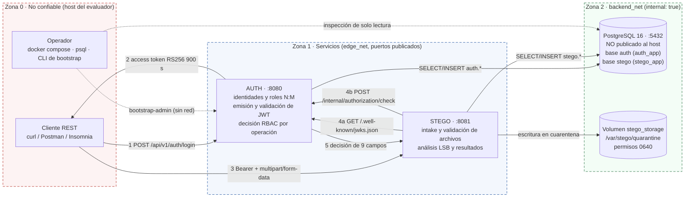
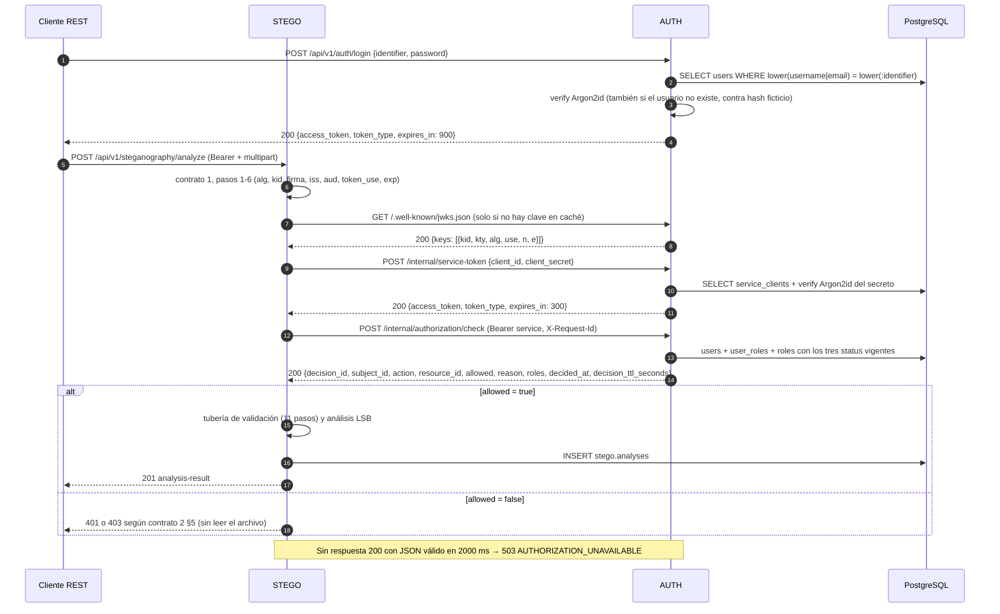
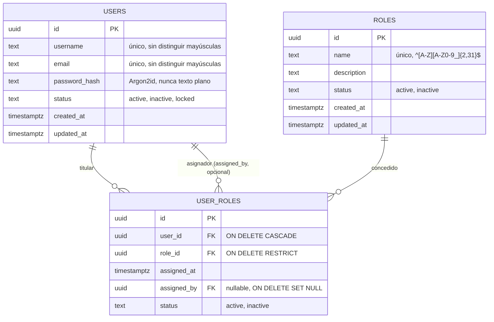
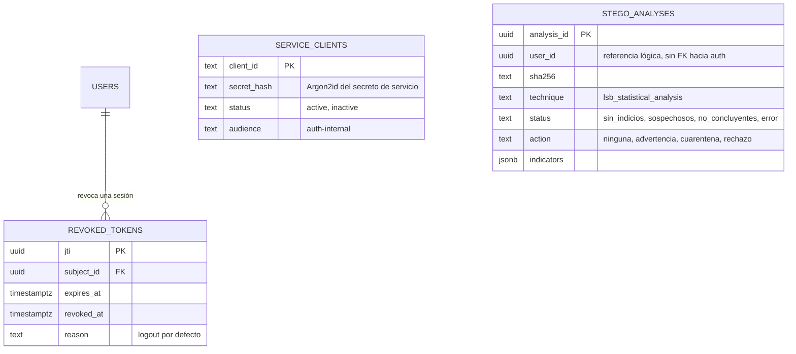

# Backend V1 — AUTH + STEGO

## Documento técnico del Proyecto Integrador del Primer Parcial

| | |
|---|---|
| **Asignatura** | Desarrollo Software Seguro |
| **Institución** | Escuela Politécnica del Ejército (ESPE) — Departamento de Ciencias de la Computación (DCCO) |
| **Trabajo** | Proyecto Integrador del Primer Parcial — *Backend: Autenticación JWT/RBAC y detección de esteganografía* |
| **Entrega** | Miércoles 4 de noviembre de 2026 |
| **Integrantes** | ⟨PENDIENTE · nombres completos e NRC del paralelo⟩ |
| **Repositorio entregado** | https://github.com/cdcaiza-5/ProyectoIntegrador (rama `main`) |
| **Versión del documento** | 1.0 — 2026-11-04 |
| **Documento hermano** | `entrega/GUION-SUSTENTACION.md` (guion cronometrado de la defensa) |

---

## 0. Alcance, fuentes de verdad y convenciones

### 0.1 Qué es este documento y qué no es

Este documento describe el **diseño técnico verificable** del Backend V1: dos microservicios REST
independientes, `AUTH` y `STEGO`, con sus contratos entre servicios, su modelo de datos, sus controles
de seguridad y su método de análisis esteganográfico. Es el documento que exige el §3 del enunciado.

No es un informe de resultados experimentales. Los resultados de ejecución, las capturas, los JSON
reales de análisis y las muestras se entregan como **evidencias reproducibles** (§11) y se citan aquí con
un marcador explícito. Donde el diseño tiene una limitación conocida, se dice (§13). Donde algo está
diseñado pero todavía no implementado, se dice (§0.4).

### 0.2 Fuentes de verdad

Todo lo técnico de este documento proviene de artefactos congelados del repositorio. No hay cifras ni
reglas inventadas para el informe: si un valor aparece aquí, está en uno de estos archivos.

| Fuente | Contenido | Estado |
|---|---|---|
| `docs/contratos/00-INDICE-Y-DECISIONES.md` | Índice de los 7 contratos, decisiones por defecto, reglas de cambio | Congelado v1.5.0 (2026-11-02) |
| `docs/contratos/01-jwt.md` | Perfil JWT: algoritmo, claims, validación en 8 pasos, ciclo de vida, claves | Congelado v1.0.0 |
| `docs/contratos/02-autorizacion-interna.md` | Contratos 2 y 3: `authorization/check`, autenticación servicio→servicio, catálogo de `reason`, traducción a HTTP | Congelado v1.0.0 |
| `docs/contratos/03-matriz-permisos.md` | Contrato 4: 13 acciones × 3 roles y mapeo endpoint → acción | Congelado v1.0.0 |
| `docs/contratos/04-esquema-identidad.md` | Contrato 5: modelo N:M, estados, integridad, bootstrap del primer ADMIN | Congelado v1.4.0 |
| `docs/contratos/05-contrato-analisis.md` | Contrato 6: tubería de 11 pasos, formato de resultado, clasificación y muestras | Congelado v1.0.0 |
| `docs/contratos/06-puertos-env-rutas.md` | Contrato 7: puertos, redes, variables, convenciones de API, catálogo de errores | Congelado v1.5.0 |
| `db/auth/001_init.sql`, `db/stego/001_init.sql` | DDL ejecutable de ambos esquemas | Presente en el repositorio |
| `contracts/authz-check.request.schema.json`, `contracts/authz-check.response.schema.json`, `contracts/analysis-result.schema.json` | JSON Schema (draft 2020-12) de los tres mensajes entre servicios | Presente en el repositorio |
| `docker-compose.yml`, `auth/.env.example`, `stego/.env.example`, `.env.example` | Topología, secretos y variables | Presente en el repositorio |
| `docs/DECISIONES.md` (D-001…D-008) | Decisiones de alcance, incluida la exclusión del pipeline ML | Vigente |

La regla del equipo, escrita en el índice de contratos, se aplica a este documento: *si algo no está en
los contratos, no se inventa en el código; se propone, se aprueba y se versiona*. En consecuencia, este
informe **no introduce** rutas, campos, códigos, puertos ni umbrales distintos de los congelados; cuando
detecta una ambigüedad, la señala y documenta la interpretación adoptada (§13.2). La única excepción son
los parámetros internos del analizador que el contrato 6 deja explícitamente al equipo —definición del
indicador, guardas de validez y submuestreo—: se fijan en §7.4 y §7.5, con su justificación, porque el
contrato exige justificarlos en el informe y no en otro sitio.

### 0.3 Convenciones de marcado

| Marca | Significado |
|---|---|
| **Contrato N §x** | Referencia al documento congelado del repositorio |
| ✓ / — | La matriz de permisos concede / no concede la acción |
| `⟨CAPTURA · Txx⟩` | Espacio para insertar una captura visual; la salida reproducible ya está en `evidence/` |
| *Ilustrativo* | Ejemplo de forma tomado de un contrato, con valores de ejemplo que **no** son resultados de ejecución |
| Unidades | Tiempos en segundos (s) y milisegundos (ms); tamaños en bytes y MiB; fechas ISO-8601 UTC con sufijo `Z` |

### 0.4 Estado de implementación en la fecha de redacción

Este documento consolida el diseño, la implementación y las evidencias disponibles en el repositorio.
Los resultados que requieren una captura visual adicional se señalan como `⟨CAPTURA · Txx⟩`; no son
funcionalidades pendientes.

| Componente | Artefacto verificable hoy | Estado |
|---|---|---|
| Topología Compose, redes, volúmenes, secretos | `docker-compose.yml` | **Presente**. Arranque reproducible: según la lista de verificación del índice de contratos §5 ya se comprobó; esta redacción no lo reejecutó. Evidencia: [`evidence/RESULTADOS.md`](../evidence/RESULTADOS.md) |
| DDL de identidad y de análisis | `db/auth/001_init.sql`, `db/stego/001_init.sql`, `db/init/00-databases.sh` | **Presente**, con las restricciones descritas en §2. Aplicación sobre volumen vacío: [`evidence/RESULTADOS.md`](../evidence/RESULTADOS.md) |
| Esquemas de los mensajes entre servicios | `contracts/*.schema.json` | **Presente** |
| Plantillas de entorno sin secretos | `.env.example`, `auth/.env.example`, `stego/.env.example` | **Presente** |
| Claves RSA de desarrollo | `scripts/gen-dev-keys.sh` (2048 bits, `.secrets/`) | **Presente** |
| AUTH: login, JWT, JWKS, CRUD, motor RBAC | `auth/app/` — `security.py`, `rbac.py`, `deps.py`, `errors.py`, `ratelimit.py`, `schemas.py`, `cli.py`, `routers/{auth,users,roles,user_roles,internal}.py` | **Implementado en el repositorio**. Evidencia de ejecución: [`evidence/RESULTADOS.md`](../evidence/RESULTADOS.md) |
| STEGO: intake, validación, analizador LSB, resultados | `stego/app/` — `upload.py`, `lsb.py`, `auth_client.py`, `routers/steganography.py`, `schemas.py`, `logging.py`, `request_ids.py` | **Implementado en el repositorio**. Evidencia de ejecución: [`evidence/RESULTADOS.md`](../evidence/RESULTADOS.md) |
| Seguridad transversal (envoltorio de error, logs, límites) | `auth/app/errors.py`, `auth/app/ratelimit.py`, `stego/app/errors.py`, `stego/app/logging.py`, `stego/app/request_ids.py` | **Implementado en el repositorio**; logs depurados verificables en T12: [`evidence/RESULTADOS.md`](../evidence/RESULTADOS.md) |
| Muestras de imagen (limpia, con carga, corrupta, falsa, enorme) | `samples/` + `scripts/gen-samples.py` | **Presentes**, generadas por script versionado. Mediciones reales: [`evidence/RESULTADOS.md`](../evidence/RESULTADOS.md) |
| Suite de pruebas | `tests/conftest.py`, `tests/test_auth.py`, `tests/test_stego.py` | **Presente**. Ejecución y salidas: [`evidence/RESULTADOS.md`](../evidence/RESULTADOS.md) |
| Colección de solicitudes REST | `docs/coleccion-rest.postman_collection.json` | **Validada**: 17 peticiones y 17 aserciones sin fallos; salida en [`evidence/newman.txt`](../evidence/newman.txt) |
| OpenAPI exportado de ambos servicios | `contracts/openapi-auth.json`, `contracts/openapi-stego.json` | **Presente y revisado**; se genera también desde `/openapi.json` |
| Evidencias T01–T12 | `evidence/` y [`evidence/RESULTADOS.md`](../evidence/RESULTADOS.md) | **Presente**: suite HTTP, unitarias, Newman y T08 reproducibles |

Estado verificado en el repositorio el **2026-11-04**. La única actividad que permanece como acción
presencial es el ensayo de la sustentación (A13); el código, pruebas, evidencias y documentación técnica
están preparados.

### 0.5 Alcance funcional de la V1

Incluido: identidad (usuarios, roles, asignación N:M), autenticación con JWT firmado, autorización RBAC
resuelta por operación contra la base vigente, endpoint interno de decisión, autenticación entre
servicios, ingesta y validación de imágenes PNG/BMP, análisis estadístico LSB, persistencia del
resultado y consulta por recurso con regla de propiedad.

Excluido por el enunciado (§1.3): interfaz web o móvil, salas, mensajería en tiempo real, cifrado de
extremo a extremo, restricción de dispositivos. Excluido por decisión del equipo: pipeline CI con
análisis de vulnerabilidades y modelo ML (D-001, D-004), mTLS (D-007, queda como mejora documentada) y
toda forma de revocación global de sesiones distinta de `revoked_tokens` por `jti`.

---

## 1. Arquitectura, límites de confianza y comunicación AUTH↔STEGO

### 1.1 Diagrama de arquitectura



El diagrama distingue tres zonas y no dos, porque el requisito del enunciado es que AUTH y STEGO sean
**procesos autónomos** (§2.1) y el aislamiento real no lo da la carpeta sino la red y las credenciales:
la base de datos no se publica, y cada servicio tiene un usuario de base distinto que no puede conectarse
a la base del otro (contrato 7 §1; verificación en §9.7).

### 1.2 Límites de confianza

| Frontera | Qué la cruza | Protección aplicada | Riesgo residual declarado |
|---|---|---|---|
| **TB-1** host → AUTH (8080) | `identifier` + `password` en el login; luego JWT en `Authorization` | Hash Argon2id en reposo; rate limit 5/60 s por IP + identificador; respuesta indistinguible entre usuario inexistente y contraseña errónea | En la demostración el transporte es HTTP porque los puertos se publican en el host. No hay TLS en la V1: ver §13.1, limitación L-01 |
| **TB-2** host → STEGO (8081) | JWT del usuario + archivo multipart | Validación criptográfica del JWT (contrato 1) **antes** de leer el archivo; tubería de 11 pasos; límites de tamaño y de píxeles | Idem transporte. Además, `ports: "8080:8080"` / `"8081:8081"` publican en todas las interfaces del host; se recomienda `127.0.0.1:8080:8080` (§13.1, L-02) |
| **TB-3** STEGO → AUTH (red interna) | `subject_token`, `action`, `resource_id`, `X-Request-Id`; y `client_id` + `client_secret` en el endpoint de token | Token de servicio RS256 con `aud: ["auth-internal"]`, `token_use: "service"`, TTL 300 s; red `backend_net` con `internal: true`; timeout 2000 ms; cero reintentos; denegación por defecto | Sin mTLS (decisión D-007). El secreto de servicio viaja en `stego/.env` y es visible con `docker inspect`: ver L-03 |
| **TB-4** AUTH → base `auth` | SQL con credenciales `auth_app` | Usuario sin privilegios sobre la base `stego`; puerto 5432 no publicado; contraseña fuera del repositorio | `auth_app` es **dueño** de su base, por lo que puede emitir DDL: ver L-04 |
| **TB-5** STEGO → base `stego` | SQL con credenciales `stego_app` | Usuario sin privilegios sobre la base `auth`; sin claves foráneas hacia `auth` | `stego.analyses.user_id` es referencia lógica: ver L-05 |
| **TB-6** STEGO → volumen | Archivo recibido, guardado en cuarentena | Nombre aleatorio UUID, extensión canónica, permisos `0640`, ruta nunca devuelta por la API ni servida por HTTP | Sin trabajo de retención implementado (`STEGO_STORAGE_RETENTION_DAYS` es informativo): ver L-06 |
| **TB-7** operador → contenedores | Comandos `docker compose`, `psql`, CLI de bootstrap | Bootstrap no alcanzable por red, de un solo uso, sin secreto en reposo y auditado (contrato 5 §5) | El operador del host es, de facto, administrador de todo el sistema: fuera del modelo de amenazas de la V1 |

### 1.3 Responsabilidades

| | AUTH | STEGO |
|---|---|---|
| Autoridad sobre identidades | **Única**. Crea y modifica `users`, `roles`, `user_roles` | Ninguna. No conoce la base `auth` ni tiene credenciales para ella |
| Emisión de tokens | **Única**. Firma con la clave privada RS256 | No firma, no emite, no conoce la clave privada |
| Verificación de tokens | Verifica los suyos en cada endpoint protegido | Verifica con la clave **pública** obtenida por JWKS |
| Decisión de autorización | **Única**. Relee `users`, `user_roles` y `roles` en cada decisión | No decide permisos. Consume la decisión y aplica solo la regla de propiedad del recurso |
| Persistencia | Esquema `auth` | Esquema `stego` + volumen `stego_storage` |
| Auditoría | Decisión con `decision_id`, `request_id`, latencia | Análisis con `sha256`, `technique`, `indicators`, `action` |

La regla que hace verificable esta separación es una prohibición, no una intención: **STEGO no consulta la
base de datos de AUTH en ningún caso, ni siquiera para leer roles** (contrato 2 §1). Su única fuente de
autorización es la respuesta de `/internal/authorization/check`.

### 1.4 Flujo completo, numerado



Los pasos 1–2 son los únicos que no requieren autorización, y por eso el login es el endpoint con rate
limit propio. El paso 11 (la decisión) se ejecuta **antes** de abrir el archivo: si AUTH deniega, STEGO no
lee el cuerpo de la petición (contrato 6 §2, paso 2). Ese orden es deliberado — procesar primero y
autorizar después convierte el servicio en un analizador anónimo con límites de CPU.

### 1.5 Infraestructura, no tercer servicio

PostgreSQL 16 y el volumen `stego_storage` son **infraestructura de apoyo**, tal como los califica el
enunciado (§2.1). No exponen API propia, no toman decisiones y no se cuentan como microservicio. La
topología Compose tiene tres servicios y dos microservicios:

| Servicio Compose | Rol | Puerto interno | Publicado | Redes |
|---|---|---|---|---|
| `auth` | Microservicio AUTH | 8080 | 8080 | `backend_net`, `edge_net` |
| `stego` | Microservicio STEGO | 8081 | 8081 | `backend_net`, `edge_net` |
| `db` | Infraestructura | 5432 | **no** | `backend_net` |

`backend_net` está declarada `internal: true`; `edge_net` existe solo porque una red interna no enruta
hacia el host y los puertos de la demostración deben publicarse (contrato 7 §1). `db` se conecta
únicamente a `backend_net`, de modo que no tiene salida a Internet ni interfaz publicada.

### 1.6 Arranque y parada autónomos (T01)

Cada servicio se levanta y se detiene por separado, sin depender del otro:

```bash
docker compose up -d auth          # STEGO no se levanta
docker compose stop stego          # AUTH sigue respondiendo
docker compose up -d stego         # se reincorpora
```

La única dependencia declarada en Compose es `auth` y `stego` → `db` con `condition: service_healthy`;
ninguna entre los dos microservicios. Es la diferencia observable entre «dos microservicios» y «dos
carpetas de una misma aplicación»: si AUTH se cae, STEGO sigue respondiendo su `/health` y sigue
denegando con 503 las operaciones que requieren decisión (§7.4).

---

## 2. Modelo de identidad y relación N:M

### 2.1 Diagrama entidad–relación



Lectura del diagrama: la relación N:M **no** está representada por un arreglo ni por una columna JSON,
sino por la tabla asociativa `user_roles`. `USERS ||--o{ USER_ROLES` significa un usuario con cero o
muchos roles; `ROLES ||--o{ USER_ROLES`, un rol con cero o muchos usuarios. La cardinalidad efectiva
N:M se obtiene al atravesar la tabla, y la unicidad de cada par la impone
`UNIQUE (user_id, role_id)`.

### 2.2 DDL y restricciones efectivas

El script `db/auth/001_init.sql` crea el esquema `auth` y las tablas. Las restricciones no son
convenciones de aplicación: están en la base, y por eso son observables desde `psql` durante la
sustentación.

| Restricción | Declaración | Efecto observable |
|---|---|---|
| PK | `id uuid PRIMARY KEY DEFAULT gen_random_uuid()` en las tres tablas | Identificador estable, UUID v4 |
| Unicidad del par | `CONSTRAINT user_roles_unique UNIQUE (user_id, role_id)` | Repetir una asignación → `409 ASSIGNMENT_EXISTS` (T06) |
| FK del titular | `user_id ... REFERENCES auth.users (id) ON DELETE CASCADE` | Sin asignaciones huérfanas; borrar el usuario borra sus asignaciones |
| FK del rol | `role_id ... REFERENCES auth.roles (id) ON DELETE RESTRICT` | Borrar un rol asignado se impide → `409 ROLE_IN_USE` |
| FK del asignador | `assigned_by ... REFERENCES auth.users (id) ON DELETE SET NULL` | La auditoría sobrevive al borrado del administrador |
| Unicidad de nombre | `CREATE UNIQUE INDEX users_username_lower_uniq ON auth.users (lower(username))` | `ana.perez` y `Ana.Perez` colisionan → `409 USER_EXISTS` |
| Unicidad de correo | índice único sobre `lower(email)` | `409 EMAIL_EXISTS` |
| Formato de rol | `CONSTRAINT roles_name_format CHECK (name ~ '^[A-Z][A-Z0-9_]{2,31}$')` | No se pueden crear roles fuera del catálogo de forma |
| Enumeración de estados | `CHECK (status IN ('active','inactive','locked'))` en `users`; `('active','inactive')` en `roles` y `user_roles` | Un estado fuera del catálogo → `422 VALIDATION_ERROR` |
| Longitud de usuario | `CHECK (char_length(username) BETWEEN 3 AND 64)` | `422 VALIDATION_ERROR` |
| Formato de correo | `CHECK (email ~ '^[^@[:space:]]+@[^@[:space:]]+\.[^@[:space:]]+$')` | `422 VALIDATION_ERROR` |
| Hash no vacío | `CHECK (char_length(password_hash) >= 20)` | Un `INSERT` manual sin hash es rechazado por la base |
| `updated_at` | trigger `auth.touch_updated_at()` en `users`, `roles`, `service_clients` | No se puede olvidar actualizarlo desde la aplicación |

El sembrado de roles es idempotente (`INSERT ... ON CONFLICT DO NOTHING`), de modo que ejecutar el script
dos veces no duplica `ADMIN`, `ANALYST` ni `USER` (contrato 5 §2).

### 2.3 `status` en las tres tablas y su efecto

La decisión de autorización exige **tres condiciones simultáneas**, todas leídas de la base en el
instante de la decisión:

1. `users.status = 'active'`
2. `user_roles.status = 'active'`
3. `roles.status = 'active'`

| Entidad | Valores | Efecto sobre la autorización | `reason` resultante si falla |
|---|---|---|---|
| `users.status` | `active`, `inactive`, `locked` | Solo `active` permite `allowed:true` | `user_inactive` (y en la validación del token, `401 SUBJECT_INACTIVE`) |
| `roles.status` | `active`, `inactive` | Un rol inactivo no concede permisos aunque la asignación esté activa | `role_inactive` |
| `user_roles.status` | `active`, `inactive` | Una asignación inactiva no concede permisos **sin borrar el histórico** | `assignment_inactive` |
| `service_clients.status` | `active`, `inactive` | Un cliente inactivo no obtiene token de servicio | `401 SERVICE_AUTH_FAILED` |

La existencia de `user_roles.status` responde a una exigencia literal del enunciado («la eliminación **o
desactivación** de una asignación», §2.2) que el modelo mínimo del Anexo A no cubre: solo `DELETE`
permite revocar, y borrar destruye el rastro. Se conservan **dos vías** de revocación — desactivar y
borrar — porque producen `reason` distintos y ambas son demostrables (T07).

### 2.4 Tablas auxiliares



`auth.revoked_tokens` y `auth.service_clients` son auxiliares y pertenecen a AUTH. `stego.analyses` vive
en otra base y **no tiene clave foránea hacia `auth`**: `user_id` es una referencia lógica verificada en
cada petición contra AUTH, no una relación de integridad referencial. La ausencia de FK es una decisión
explícita (contrato 6 §5): una FK entre bases crearía acoplamiento y obligaría a compartir credenciales,
que es exactamente lo que el enunciado prohíbe. El costo está en §13.1, L-05.

### 2.5 Invariantes verificables

| Invariante | Cómo se comprueba |
|---|---|
| Un usuario puede tener N roles | `POST /api/v1/user-roles` dos veces con `user_id` igual y `role_id` distinto → dos filas 201 |
| Un rol puede estar en N usuarios | `POST /api/v1/user-roles` con `role_id` igual y `user_id` distinto → dos filas 201 |
| No hay pares duplicados | `SELECT count(*) FROM auth.user_roles WHERE user_id = $1 AND role_id = $2` ≤ 1 |
| No hay asignaciones huérfanas | Las FK lo impiden; `404 USER_NOT_FOUND` / `404 ROLE_NOT_FOUND` al asignar mal |
| Una asignación revocada deja de conceder | `DELETE` o `PATCH status=inactive` y la siguiente decisión devuelve `allowed:false` |

Verificación directa durante la defensa:

```bash
docker compose exec db psql -U auth_app -d auth -c "
SELECT u.username, r.name, ur.status
FROM auth.user_roles ur
JOIN auth.users u ON u.id = ur.user_id
JOIN auth.roles r ON r.id = ur.role_id
ORDER BY 1, 2;"
```

---

## 3. Autenticación con JWT

### 3.1 Qué demuestra y qué no demuestra un JWT

Un JWT firmado demuestra que **el sujeto presentó credenciales válidas ante AUTH en el instante `iat`** y
que el token no fue alterado desde entonces. No demuestra que sus permisos sigan siendo los mismos: entre
`iat` y ahora pudieron retirarse asignaciones, desactivarse un rol o desactivarse el usuario. Por eso
este diseño separa dos actos que otros sistemas mezclan:

- **Autenticación** (§3): ¿este token lo emitió AUTH y sigue vigente? Se resuelve con criptografía y,
  cuando aplica, con la base de AUTH.
- **Autorización** (§4): ¿este sujeto puede ejecutar esta acción sobre este recurso **ahora**? Se resuelve
  consultando la base de identidad en cada decisión.

El token, por tanto, **no lleva roles**. La decisión de diseño está congelada (contratos 1 y 2, decisión
«`roles` dentro del JWT: **Prohibido**») y su consecuencia es directa: es imposible autorizar con datos
obsoletos porque los datos de autorización nunca viajan en el token.

### 3.2 Perfil del access token

| Elemento | Valor congelado |
|---|---|
| `alg` | `RS256` (RSA ≥ 2048 bits, clave asimétrica) |
| `typ` | `JWT` |
| `kid` | Obligatorio en la cabecera; debe existir en JWKS. En la entrega: `auth-2026-11` |
| Emisor `iss` | `auth-service` |
| Audiencias `aud` | `["auth-api", "stego-api"]`; cada servicio exige la suya |
| Vigencia `exp` | `iat + AUTH_ACCESS_TOKEN_TTL_SECONDS` = **900 s** |
| Identificador `jti` | UUID v4, necesario para la revocación por `logout` |
| `token_use` | `access` para usuario; `service` para token de servicio |

Claims del token de usuario (forma ilustrativa, contrato 1 §2):

```json
{
  "iss": "auth-service",
  "sub": "3f1c2a9e-5b7d-4c8e-9a10-7d6f5e4b3c21",
  "aud": ["auth-api", "stego-api"],
  "iat": 1762100000,
  "exp": 1762100900,
  "jti": "b0e1d2c3-4a5f-4e6d-8c9b-0a1b2c3d4e5f",
  "token_use": "access",
  "username": "ana.perez"
}
```

`sub` es `users.id` y es la **única** identidad reconocida. `username` es un dato de presentación y
**nunca** se usa para decidir.

Prohibido dentro del token (contrato 1 §2): roles, permisos, scopes de negocio, `password_hash`, correo,
documento de identidad, claves o cualquier otro dato personal. Un token con un claim `role` añadido a mano
no otorga acceso: el payload está firmado y, aunque no lo estuviera, ningún servicio lee roles de ahí.
El caso está en la lista de aceptación del contrato 1 y en la batería de pruebas de seguridad (§11).

### 3.3 Validación en ocho pasos

Ambos servicios aplican el mismo orden; el primer fallo corta la cadena. Ningún paso consulta roles.

| # | Verificación | Fallo |
|---|---|---|
| 1 | Cabecera decodificable, `alg = RS256`, `typ = JWT`, `kid` conocido | `401 TOKEN_INVALID` |
| 2 | Firma válida con la clave pública del `kid` | `401 TOKEN_INVALID` |
| 3 | `iss = auth-service` | `401 TOKEN_INVALID` |
| 4 | `aud` contiene el identificador del servicio que valida | `401 TOKEN_INVALID` |
| 5 | `token_use = access` | `401 TOKEN_INVALID` |
| 6 | `exp` > ahora (desfase 60 s), `iat` no futuro (±60 s) | `401 TOKEN_EXPIRED` |
| 7 | `jti` no está en `auth.revoked_tokens` | `401 TOKEN_REVOKED` |
| 8 | `sub` es UUID y el usuario existe con `status = 'active'` | `401 TOKEN_INVALID` / `401 SUBJECT_INACTIVE` |

La lista cerrada de algoritmos (`RS256`) es la defensa contra *algorithm confusion*: se rechazan `none`,
`HS256` y cualquier variante no listada, en lugar de aceptar «el algoritmo que diga el token». Es la
recomendación de RFC 8725 y está en la lista de aceptación del contrato 1.

**Alcance de los pasos 7 y 8.** Los pasos 1–6 los ejecuta STEGO localmente, con la clave pública. Los
pasos 7 y 8 requieren la base de AUTH, que STEGO no puede leer, así que se ejecutan **en AUTH**, dentro de
la misma petición de autorización (contrato 2: «AUTH revalida el token del usuario»). El efecto neto es el
correcto —un token revocado o de un usuario desactivado no opera— y el costo es que la clasificación local
de STEGO no distingue «revocado» de «inválido»: AUTH devuelve `reason: token_invalid` porque el catálogo
de `reason` no tiene `token_revoked`, y STEGO traduce a `401 TOKEN_INVALID`. La diferencia se documenta en
§13.2 en lugar de esconderse.

### 3.4 Credenciales: Argon2id y resistencia al canal de tiempos

- Las contraseñas se almacenan como `password_hash` con **Argon2id** (`argon2-cffi` fijado en
  `auth/requirements.txt`). No existe ninguna ruta que devuelva el hash: la columna no se serializa en
  ninguna respuesta.
- El login recibe un único campo `identifier` que acepta `username` **o** `email`.
- El login **siempre** ejecuta la verificación de contraseña, incluso cuando el usuario no existe,
  comparando contra un hash ficticio precalculado. Así el tiempo de respuesta no revela si un
  identificador existe (mitigación de *timing attack*, contrato 1 §3).
- Credenciales inválidas → `401 AUTH_INVALID_CREDENTIALS`.
- Rate limit: `AUTH_LOGIN_RATE_LIMIT_PER_MINUTE = 5` por IP + identificador, con bloqueo de 60 s al
  exceder → `429 RATE_LIMITED`.

### 3.5 Gestión de claves y rotación por `kid`

| Aspecto | Implementación |
|---|---|
| Clave privada | Solo en AUTH, montada como secreto de Compose en `AUTH_JWT_PRIVATE_KEY_PATH` (`/run/secrets/jwt_private.pem`). No se versiona ni se copia a la imagen |
| Clave pública | Expuesta en `GET /.well-known/jwks.json`, pública y sin secretos |
| Distribución | STEGO obtiene las claves de `STEGO_AUTH_JWKS_URL` con caché corta y timeout de 1500 ms |
| Rotación | Publicar el nuevo `kid` en JWKS → empezar a firmar con él → retirar el `kid` anterior cuando hayan expirado los tokens emitidos con él |
| Falla de JWKS | Si no hay caché válida y JWKS no responde, STEGO **deniega** (`503 AUTHORIZATION_UNAVAILABLE`): no puede establecer que el token sea válido |
| `kid` aceptado | AUTH solo acepta el `kid` configurado (`AUTH_JWT_KID`); STEGO resuelve el `kid` contra JWKS y, si no está publicado, responde `401 TOKEN_INVALID` antes de intentar la firma |

Forma de la respuesta JWKS (ilustrativa; RFC 7517; solo material público):

```json
{
  "keys": [
    {
      "kid": "auth-2026-11",
      "kty": "RSA",
      "alg": "RS256",
      "use": "sig",
      "n": "<módulo en base64url>",
      "e": "AQAB"
    }
  ]
}
```

En la entrega se usa **una sola clave**, generada por `scripts/gen-dev-keys.sh` con 2048 bits. El
procedimiento de rotación se documenta aunque no se ejecute, y la clave de desarrollo no es la de
producción: §13.1, L-07.

### 3.6 Ciclo de vida y revocación

| Evento | Efecto sobre el token |
|---|---|
| `POST /api/v1/auth/login` con credenciales válidas | Se emite un access token de 900 s |
| `POST /api/v1/auth/logout` | `204` e inserción del `jti` en `auth.revoked_tokens` con su `exp`; ese token deja de servir de inmediato |
| Expiración natural | `exp` superado → `401 TOKEN_EXPIRED` |
| Cambio de rol o de estado del usuario | **No** invalida el token: sigue siendo válido y la **decisión de autorización cambia**. Es el mecanismo que demuestra T07 |
| Desactivación del usuario | El token deja de servir porque falla el paso 8 (`401 SUBJECT_INACTIVE`) |

La revocación es por `jti`, no por usuario: cerrar una sesión no cierra las demás. Se descartó
`tokenVersion` global precisamente por eso (D-005). La limpieza de `revoked_tokens` se hace por trabajo
periódico o borrado de lo expirado y no puede bloquear el login.

---

## 4. Autorización RBAC con verificación de roles vigentes

### 4.1 El JWT identifica; la base autoriza

Cada operación protegida ejecuta la misma secuencia, sin excepciones y sin caché:

1. Validación del token (§3.3).
2. Lectura de la base vigente: usuario, asignaciones activas y roles activos.
3. Comprobación de que la acción solicitada está concedida por la **unión** de los roles activos.
4. Decisión: `allowed: true/false` con `reason` legible por máquina.
5. Traducción a HTTP: `200/201` si se permite; `401` o `403` si no.

La consulta que resuelve los pasos 2–3 no filtra por token ni por claim; filtra por estado:

```sql
SELECT r.name
FROM auth.users u
JOIN auth.user_roles ur ON ur.user_id = u.id AND ur.status = 'active'
JOIN auth.roles      r  ON r.id = ur.role_id  AND r.status = 'active'
WHERE u.id = $1
  AND u.status = 'active';
```

Si esa consulta devuelve el conjunto vacío, la decisión es `allowed:false`. El `reason` se elige
distinguiendo el motivo: el usuario no existe (`subject_not_found`), está inactivo (`user_inactive`), no
tiene asignación para la acción (`no_active_role_for_action`), la asignación fue retirada
(`assignment_missing`), está desactivada (`assignment_inactive`) o el rol está inactivo
(`role_inactive`).

**Qué es política y qué es dato.** La matriz acción → roles es una política estática versionada, derivada
del contrato 4; es legítimo que viva en el código como constante, igual que el catálogo de `reason`. Lo
que **nunca** se codifica es la asignación usuario → roles: esa siempre se lee de `auth.user_roles`. La
regla del contrato 4 —«no existe ninguna lista de usuarios o permisos hardcodeada»— se cumple en el
sentido que importa: no hay ninguna lista de *quién* tiene qué. Una alternativa futura, si el catálogo de
acciones creciera, es materializar la política en una tabla `role_permissions`; hoy no aporta y añade una
consulta.

### 4.2 Endpoint interno de decisión

`POST /internal/authorization/check` es la única vía por la que STEGO obtiene autorización.

| Cabecera | Obligatoria | Regla |
|---|---|---|
| `Authorization` | sí | `Bearer <service token>` con `aud: ["auth-internal"]` y `token_use: "service"` |
| `Content-Type` | sí | `application/json` |
| `X-Request-Id` | sí | UUID v4; se propaga desde STEGO y se registra en ambos servicios |

Solicitud (esquema `contracts/authz-check.request.schema.json`, `additionalProperties: false`):

```json
{
  "subject_token": "<JWT_DEL_USUARIO_SIN_PREFIJO_BEARER>",
  "action": "steganography.analyze",
  "resource_id": null
}
```

Respuesta `200` con **exactamente nueve campos** (`additionalProperties: false` en el esquema; un campo de
más invalida el contrato y la prueba de aceptación):

| Campo | Tipo | Descripción |
|---|---|---|
| `decision_id` | UUID | Identificador de la decisión, para auditoría |
| `subject_id` | UUID \| null | `sub` del token; `null` si el token es inválido |
| `action` | string | Eco de la acción solicitada |
| `resource_id` | UUID \| null | Eco del recurso |
| `allowed` | boolean | Decisión final de AUTH |
| `reason` | string (enum) | Motivo legible por máquina |
| `roles` | array de string | Roles **efectivos en el instante de la decisión** (puede ser `[]`) |
| `decided_at` | string ISO-8601 UTC | Momento de la decisión |
| `decision_ttl_seconds` | integer | `30`; informativo, **no** es una caché |

Forma ilustrativa (contrato 2 §3):

```json
{
  "decision_id": "9a7b6c5d-4e3f-4a2b-8c1d-0e9f8a7b6c5d",
  "subject_id": "3f1c2a9e-5b7d-4c8e-9a10-7d6f5e4b3c21",
  "action": "steganography.analyze",
  "resource_id": null,
  "allowed": true,
  "reason": "active_role_grants_permission",
  "roles": ["ANALYST"],
  "decided_at": "2026-11-02T19:40:00Z",
  "decision_ttl_seconds": 30
}
```

`allowed: false` con HTTP `200` **es una decisión válida, no un error**. STEGO la traduce al código HTTP
que corresponde al cliente. Cualquier respuesta que no sea `200` con JSON válido se trata como denegación.

### 4.3 Catálogo de `reason`

| `reason` | `allowed` | Significado |
|---|:---:|---|
| `active_role_grants_permission` | true | Un rol activo y vigente concede la acción |
| `no_active_role_for_action` | false | Usuario activo, pero ningún rol vigente concede la acción |
| `user_inactive` | false | `users.status` ≠ `active` |
| `role_inactive` | false | El rol que concedería la acción está inactivo |
| `assignment_missing` | false | La asignación fue retirada (`DELETE`) |
| `assignment_inactive` | false | La asignación existe pero su `status` es `inactive` |
| `unknown_action` | false | La acción no pertenece al catálogo congelado |
| `token_invalid` | false | Firma, `iss`, `aud`, `typ`, `jti` o `sub` inválidos |
| `token_expired` | false | `exp` superado |
| `subject_not_found` | false | `sub` sin usuario asociado |

Una acción desconocida **no** es un error de validación: es una denegación con `reason: unknown_action`
y HTTP `200`. Así el cliente no puede distinguir «acción inexistente» de «acción sin permiso» por el
código HTTP, y el registro de auditoría conserva el intento. El catálogo tiene diez valores; añadir uno
nuevo es un cambio de contrato.

### 4.4 Autenticación servicio→servicio

STEGO no puede llamar al endpoint interno con el token del usuario: sería el usuario decidiendo sobre sí
mismo. Se autentica como servicio:

| Elemento | Valor congelado |
|---|---|
| Esquema | OAuth2 `client_credentials` simplificado, implementado a mano |
| Endpoint de token | `POST /internal/service-token` en AUTH |
| Credenciales | `STEGO_SERVICE_CLIENT_ID` + `STEGO_SERVICE_CLIENT_SECRET` |
| Almacenamiento del secreto | AUTH guarda solo el **hash Argon2id** en `auth.service_clients.secret_hash` |
| Token de servicio | JWT `RS256`, `token_use: "service"`, `sub: "service:stego"`, `aud: ["auth-internal"]`, TTL **300 s** |
| Renovación | Caché en STEGO; se renueva a los 240 s, antes de expirar |
| Transporte | Red interna de Docker (`backend_net`, `internal: true`); los puertos se publican solo para la demostración |

Un token de **usuario** presentado en `/internal/*` se rechaza con `401 SERVICE_AUTH_FAILED`: la audiencia
y el `token_use` son distintos a propósito, de modo que un token de usuario filtrado no sirve para pedir
decisiones. Es una separación de privilegios dentro del mismo mecanismo de firma.

### 4.5 Denegación por defecto

| Situación | Resultado |
|---|---|
| Sin token de servicio en el endpoint interno | `401 SERVICE_AUTH_FAILED` |
| Token de servicio inválido, vencido o de audiencia incorrecta | `401 SERVICE_AUTH_FAILED` |
| AUTH no responde en **2000 ms** | `503 AUTHORIZATION_UNAVAILABLE` |
| AUTH responde `5xx`, HTML o JSON que no valida | `503 AUTHORIZATION_UNAVAILABLE` |
| Reintentos | **0**. Un fallo de autorización no se reintenta: se deniega |
| Decisión reutilizada de una petición anterior | Prohibido. `decision_id` no se cachea ni se recicla |

El timeout de 2000 ms es el presupuesto completo (conexión + lectura). La consecuencia es que un AUTH
lento degrada la disponibilidad de STEGO: es el precio de no procesar archivos sin decisión, y se asume
explícitamente (§8, riesgo R-08).

### 4.6 Regla de propiedad del recurso

`steganography.results.read` es la única acción con restricción por recurso. AUTH decide el nivel de rol;
STEGO aplica la propiedad:

```
puede_leer = (allowed == true)
             AND ( "ADMIN" ∈ roles
                   OR analysis.user_id == subject_id )
```

- `resource_id` inexistente → `404 RESULT_NOT_FOUND`.
- Existe, pero el solicitante no es ADMIN ni el titular → `403 RESULT_FORBIDDEN`.
- Para `steganography.analyze`, `resource_id` es `null`: la autorización es puramente de rol.

Esta es la **única** regla de negocio que STEGO evalúa por sí mismo. No amplía permisos; solo restringe el
acceso a un resultado concreto, y lo hace con datos que ya posee (`user_id` de la fila y `subject_id` de la
decisión), sin consultar la base de AUTH.

---

## 5. Matriz de roles y permisos

### 5.1 Roles

| Rol | Propósito | Regla de mínimo privilegio |
|---|---|---|
| `ADMIN` | Administración de identidades y operaciones privilegiadas | Único que crea y edita usuarios, roles y asignaciones; además puede analizar y leer cualquier resultado |
| `ANALYST` | Análisis de imágenes y consulta de sus resultados | No administra identidades; no ve resultados ajenos |
| `USER` | Acceso al propio perfil | No analiza imágenes; solo consulta sus propios resultados |

Un usuario puede acumular roles y la decisión es la **unión** de los permisos de sus roles activos. Los
roles con `status = 'inactive'` se ignoran aunque la asignación exista.

### 5.2 Matriz de 13 acciones × 3 roles

Fuente: contrato 4 §2. Es la fuente única de verdad de la autorización; cualquier otro listado en código,
documentación o diapositivas se deriva de aquí.

| # | Acción | ADMIN | ANALYST | USER | Endpoint que la ejerce |
|---|---|:---:|:---:|:---:|---|
| 1 | `auth.profile.read` | ✓ | ✓ | ✓ | `GET /api/v1/auth/profile` |
| 2 | `auth.logout` | ✓ | ✓ | ✓ | `POST /api/v1/auth/logout` |
| 3 | `users.create` | ✓ | — | — | `POST /api/v1/users` |
| 4 | `users.list` | ✓ | — | — | `GET /api/v1/users` |
| 5 | `users.update` | ✓ | — | — | `PATCH /api/v1/users/:id` |
| 6 | `roles.create` | ✓ | — | — | `POST /api/v1/roles` |
| 7 | `roles.list` | ✓ | — | — | `GET /api/v1/roles` |
| 8 | `roles.update` | ✓ | — | — | `PATCH /api/v1/roles/:id` |
| 9 | `user_roles.create` | ✓ | — | — | `POST /api/v1/user-roles` |
| 10 | `user_roles.update` | ✓ | — | — | `PATCH /api/v1/user-roles/:id` |
| 11 | `user_roles.delete` | ✓ | — | — | `DELETE /api/v1/user-roles/:id` |
| 12 | `steganography.analyze` | ✓ | ✓ | — | `POST /api/v1/steganography/analyze` (STEGO) |
| 13 | `steganography.results.read` | ✓ | ✓ | ✓ | `GET /api/v1/steganography/results/:id` (STEGO) + propiedad |

Consecuencias que se verifican en la defensa: un `USER` recibe `403` al analizar (T04); un `ANALYST`
recibe `403` en todo el CRUD administrativo; un `ADMIN` sin rol `ANALYST` **sí** puede analizar, porque la
matriz lo permite; y un `USER` puede pedir `results.read` pero solo obtiene lo suyo.

> **Nota de consistencia documental.** La guía interna `docs/DOCUMENTACION-TECNICA.md` habla de «doce
> acciones» porque se escribió antes de la versión 1.2.0 del contrato 5, que añadió `user_roles.update`
> junto con `PATCH /api/v1/user-roles/:id`. La fuente de verdad es el contrato 4, que tiene **trece**
> filas. La matriz de arriba es esa.

### 5.3 Rutas internas y de infraestructura (no públicas)

| Método | Ruta | Control | Códigos esperados |
|---|---|---|---|
| POST | `/internal/authorization/check` | Solo servicio autenticado (contrato 2) | `200`, `400`, `401`, `429`, `500` |
| POST | `/internal/service-token` | Credenciales de cliente | `200`, `400`, `401`, `429` |
| GET | `/.well-known/jwks.json` | Público, solo clave pública | `200` |
| GET | `/health` | Público, sin datos sensibles | `200` |

Ninguna de las cuatro lleva el prefijo `/api/v1`: las tres primeras porque así lo exige el enunciado o la
convención de descubrimiento, y `/health` porque es una convención de salud sin versión (contrato 7 §5).

### 5.4 Denegaciones: `401` no es `403`

| Caso | HTTP | Código |
|---|---|---|
| Sin cabecera `Authorization` | 401 | `TOKEN_MISSING` |
| Token inválido, mal firmado, `alg` no permitido, `iss`/`aud` incorrectos | 401 | `TOKEN_INVALID` |
| Token vencido | 401 | `TOKEN_EXPIRED` |
| Token revocado por logout | 401 | `TOKEN_REVOKED` |
| Usuario desactivado | 401 | `SUBJECT_INACTIVE` |
| Autenticado sin el rol requerido | 403 | `FORBIDDEN` |
| Recurso ajeno sin ser ADMIN | 403 | `RESULT_FORBIDDEN` |
| AUTH no responde para autorizar | 503 | `AUTHORIZATION_UNAVAILABLE` |

La regla es una frase y se aplica sin excepciones: **`401` = no sé quién eres; `403` = sé quién eres,
pero no puedes.** Mezclarlas rompe T03/T04 y delata que la autorización se resolvió con el token y no con
la base.

---

## 6. API, contratos y especificaciones OpenAPI

### 6.1 Superficie de AUTH

| Método | Ruta | Acción / control | Éxito | Errores |
|---|---|---|---|---|
| POST | `/api/v1/auth/login` | Público, 5/60 s | `200` | `401 AUTH_INVALID_CREDENTIALS`, `422`, `429 RATE_LIMITED` |
| GET | `/api/v1/auth/profile` | `auth.profile.read` | `200` | `401`, `403` |
| POST | `/api/v1/auth/logout` | `auth.logout` | `204` | `401` |
| POST | `/api/v1/users` | `users.create` | `201` | `401`, `403`, `409`, `422` |
| GET | `/api/v1/users` | `users.list` | `200` | `401`, `403` |
| PATCH | `/api/v1/users/:id` | `users.update` | `200` | `401`, `403`, `404` |
| POST | `/api/v1/roles` | `roles.create` | `201` | `401`, `403`, `409`, `422` |
| GET | `/api/v1/roles` | `roles.list` | `200` | `401`, `403` |
| PATCH | `/api/v1/roles/:id` | `roles.update` | `200` | `401`, `403`, `404` |
| POST | `/api/v1/user-roles` | `user_roles.create` | `201` | `401`, `403`, `404`, `409` |
| PATCH | `/api/v1/user-roles/:id` | `user_roles.update` (activar/desactivar) | `200` | `401`, `403`, `404` |
| DELETE | `/api/v1/user-roles/:id` | `user_roles.delete` | `204` | `401`, `403`, `404` |
| POST | `/internal/service-token` | Credenciales de cliente | `200` | `400`, `401`, `429` |
| POST | `/internal/authorization/check` | Solo servicio | `200` | `400`, `401`, `429`, `500` |
| GET | `/.well-known/jwks.json` | Público | `200` | — |
| GET | `/health` | Público | `200` | — |

### 6.2 Superficie de STEGO

| Método | Ruta | Control | Éxito | Errores |
|---|---|---|---|---|
| POST | `/api/v1/steganography/analyze` | JWT + `steganography.analyze` + decisión | `201` | `401`, `403`, `413`, `415`, `422`, `503` |
| GET | `/api/v1/steganography/results/:id` | JWT + `steganography.results.read` + propiedad | `200` | `401`, `403`, `404`, `503` |
| GET | `/health` | Público | `200` | — |

`analyze` recibe `multipart/form-data` con `file` obligatorio (un solo archivo) y `note` opcional
(≤ 500 caracteres). Tamaño máximo `STEGO_MAX_UPLOAD_BYTES` = 5 242 880 bytes (5 MiB).

El contrato 6 §1 describe `note` como «metadato que se guarda»; la tabla congelada `stego.analyses` no tiene
columna para texto libre y añadirla cambiaría el contrato 6 §5, así que la implementación **valida y
descarta** el campo: un `note` de más de 500 caracteres devuelve `422`, y uno válido no se persiste. Se
documenta como desviación en §13.2 (A-i); la alternativa correcta, si se quiere conservar, es versionar el
contrato y añadir la columna.

### 6.3 Convenciones transversales

| Convención | Valor |
|---|---|
| Codificación | JSON UTF-8, `application/json` (salvo multipart en `analyze`) |
| Nombres de campo | `snake_case` en todo el JSON de la API; los claims del JWT conservan la forma de RFC 7519 |
| Fechas | ISO-8601 UTC con `Z` (`2026-11-02T19:40:00Z`) |
| Identificadores | UUID v4 |
| Trazabilidad | `X-Request-Id`: se acepta solo si cumple `^[A-Za-z0-9._-]{1,64}$`; en caso contrario se genera. STEGO la propaga a AUTH y, si el identificador recibido no tiene forma de UUID v4, genera uno para la llamada interna (el contrato 2 §3 exige UUID en `/internal/*`) y registra la correspondencia |
| Paginación | `?page` (≥ 1) y `?limit` (1–100, por defecto 20) con `{"items": [...], "page": 1, "limit": 20, "total": 0}` |
| Versión | Prefijo `/api/v1` en los endpoints públicos; las cuatro rutas de §5.3 quedan excluidas |
| Errores | Envoltorio único (§6.5) |

### 6.4 Especificaciones OpenAPI

Ambos servicios usan FastAPI, que genera el documento OpenAPI 3.1 automáticamente en `/openapi.json` y
monta Swagger UI en `/docs` y ReDoc en `/redoc`. La especificación que se entrega es **la exportada desde
la aplicación en ejecución**, no una escrita a mano que pueda divergir del comportamiento:

```bash
curl -s http://localhost:8080/openapi.json -o contracts/openapi-auth.json
curl -s http://localhost:8081/openapi.json -o contracts/openapi-stego.json
```

Requisitos de contenido antes de dar la especificación por buena:

- Los 16 endpoints de AUTH y los 3 de STEGO, con esquema de petición, de respuesta y **todos** los códigos
  de error del catálogo aplicables a cada ruta.
- El endpoint interno marcado como **solo servicio**: `security` con el esquema de token de servicio y una
  descripción que diga que no es público ni se invoca con token de usuario.
- El envoltorio de error declarado como respuesta por defecto, con su `code` enumerado.
- `analyze` con `multipart/form-data` y el campo `file` binario, y la respuesta `201` apuntando al esquema
  `AnalysisResult`. En la implementación esto se declara con `openapi_extra` (el cuerpo multipart no se
  deduce del tipo de parámetro) y con `responses={401,403,413,415,422,503}`; `results/{id}` declara
  `{401,403,404,503}`. Si la especificación exportada no muestra esos códigos, el `responses` se perdió en el
  camino y hay que corregirlo antes de entregar.
- Las cuatro rutas sin prefijo visibles en la especificación de AUTH.
- `/health` figura en el contrato 7 como ruta pública; en el esqueleto actual está excluido del esquema
  (`include_in_schema=False`) por ser infraestructura. Si la especificación entregada no lo incluye, debe
  decirse al pie para que no parezca una omisión.

Estado de los dos artefactos: [`contracts/openapi-auth.json`](../contracts/openapi-auth.json) y
[`contracts/openapi-stego.json`](../contracts/openapi-stego.json) fueron exportados y revisados. La
colección [`docs/coleccion-rest.postman_collection.json`](../docs/coleccion-rest.postman_collection.json)
se ejecutó con Newman: 17 peticiones, 17 aserciones y 0 fallos.

### 6.5 Envoltorio de error único

```json
{
  "error": {
    "code": "TOKEN_INVALID",
    "message": "El token no es válido.",
    "details": [{ "field": "authorization", "issue": "signature_mismatch" }],
    "request_id": "8f1c2a9e-5b7d-4c8e-9a10-7d6f5e4b3c21",
    "timestamp": "2026-11-02T19:40:00Z"
  }
}
```

`code` es estable y está probado; `message` es para humanos y puede cambiar; `details` es opcional. Nunca
se devuelven *stack traces*, rutas de archivo internas, SQL ni trazas de librería. El `request_id` es el
mismo que atraviesa los dos servicios, y es lo que permite correlacionar una denegación en STEGO con su
decisión en AUTH sin registrar el token.

### 6.6 Catálogo de códigos de error

| Código | HTTP típico | Servicio | Cuándo |
|---|---|---|---|
| `VALIDATION_ERROR` | 422 | ambos | Entrada que no valida |
| `TOKEN_MISSING` | 401 | ambos | Sin cabecera `Authorization` |
| `TOKEN_INVALID` | 401 | ambos | Firma, claims o `alg` inválidos |
| `TOKEN_EXPIRED` | 401 | ambos | `exp` superado |
| `TOKEN_REVOKED` | 401 | ambos | `jti` revocado por logout |
| `SUBJECT_INACTIVE` | 401 | ambos | Usuario desactivado |
| `AUTH_INVALID_CREDENTIALS` | 401 | AUTH | Login fallido |
| `FORBIDDEN` | 403 | ambos | Rol ausente para la acción |
| `RESULT_FORBIDDEN` | 403 | STEGO | Resultado ajeno sin ser ADMIN |
| `USER_NOT_FOUND` / `ROLE_NOT_FOUND` / `ASSIGNMENT_NOT_FOUND` | 404 | AUTH | Referencia inexistente |
| `RESULT_NOT_FOUND` | 404 | STEGO | `analysis_id` inexistente |
| `USER_EXISTS` / `EMAIL_EXISTS` | 409 | AUTH | Unicidad de usuario |
| `ROLE_EXISTS` | 409 | AUTH | Unicidad de rol |
| `ASSIGNMENT_EXISTS` | 409 | AUTH | `UNIQUE (user_id, role_id)` (T06) |
| `ROLE_IN_USE` | 409 | AUTH | `ON DELETE RESTRICT` |
| `PAYLOAD_TOO_LARGE` | 413 | ambos | Tamaño o dimensiones excedidas |
| `UNSUPPORTED_MEDIA_TYPE` | 415 | STEGO | Extensión o tipo declarado fuera de la lista |
| `FILE_SIGNATURE_MISMATCH` | 415 | STEGO | *Magic bytes* incoherentes con el tipo |
| `IMAGE_UNPROCESSABLE` | 422 | STEGO | No decodifica como imagen válida |
| `RATE_LIMITED` | 429 | ambos | Límite de tasa excedido |
| `SERVICE_AUTH_FAILED` | 401 | AUTH | Token de servicio ausente o inválido |
| `AUTHORIZATION_UNAVAILABLE` | 503 | STEGO | AUTH inaccesible o respuesta no verificable |
| `INTERNAL_ERROR` | 500 | ambos | Fallo no controlado; sin trazas al cliente |

---

## 7. Detección de esteganografía

### 7.1 Qué se analiza y por qué LSB estadístico

La esteganografía LSB sustituye el bit menos significativo de cada muestra de color por bits del mensaje.
Es la técnica de ocultamiento más simple y la más frecuente en ejercicios y en herramientas de uso común,
porque el cambio es visualmente imperceptible: reemplazar el LSB altera cada muestra en 0 o en ±1, muy por debajo
del umbral de percepción.

El método elegido es el **análisis estadístico del plano LSB con prueba de chi-cuadrado**, no la extracción
del mensaje. La razón es la del enunciado: el servicio debe **detectar posibles datos ocultos**, no
descifrarlos, y no puede conocer la clave ni el formato del mensaje. Un detector que intente extraer solo
funciona contra el esquema exacto con el que se ocultó; un detector estadístico funciona contra cualquier
esquema que altere el plano LSB de forma aproximadamente aleatoria, que es el caso de todas las
herramientas de inserción secuencial.

La técnica se apoya en una propiedad de las imágenes naturales: los valores de intensidad no son
equiprobables dentro de cada pareja `{2k, 2k+1}`. En zonas planas, cuantización y suavizado hacen que uno
de los dos valores de la pareja aparezca mucho más que el otro. La sustitución LSB **iguala** esas
frecuencias, porque el bit que se escribe es esencialmente aleatorio. La prueba de chi-cuadrado mide
exactamente esa igualación.

### 7.2 Formatos soportados y por qué no JPEG

| Formato | Tipo MIME | ¿Se analiza? | Motivo |
|---|---|---|---|
| PNG | `image/png` | Sí | Compresión sin pérdida: los valores de píxel llegan intactos al analizador |
| BMP | `image/bmp`, `image/x-ms-bmp` | Sí | Sin compresión: es el caso más limpio para el análisis LSB |
| JPEG | `image/jpeg` | **No**: `415 UNSUPPORTED_MEDIA_TYPE` | La compresión con pérdida (DCT + cuantización) reescribe el plano LSB por completo: cualquier carga previa desaparece y el análisis no tendría sentido |
| GIF, WebP, TIFF | — | **No**: `415` | Fuera de la lista blanca del contrato 6 |

Rechazar JPEG no es una limitación técnica del analizador, es una decisión de coherencia: analizar un JPEG
produciría un `sin_indicios` que el usuario leería como «esta imagen está limpia», cuando en realidad el
formato impide saberlo. Ese falso negativo presentado como resultado es peor que el rechazo explícito. El
costo es de cobertura: quien quiera ocultar datos solo tiene que usar JPEG para quedar fuera del alcance
del detector (§7.6, S-5).

La lista blanca se valida en tres planos independientes —extensión, tipo declarado y *magic bytes*— porque
cada uno se puede falsificar por separado.

Dentro de PNG se analizan las imágenes que decodifican a `RGB`, `RGBA`, `L`, `LA` o `P`. Las de 1 bit,
16 bits por canal o coma flotante no se procesan: se clasifican `no_concluyentes` con `advertencia`, no se
rechazan con `415`, porque el formato es válido y lo que falta es la capacidad de medirlo con esta técnica.

### 7.3 Tubería de validación en once pasos

Se ejecuta en este orden y corta en el primer fallo (contrato 6 §2). Los pasos 1–2 son de autorización y
ocurren **antes** de leer el archivo.

| # | Paso | Fallo |
|---|---|---|
| 1 | JWT válido (contrato 1) | `401 TOKEN_INVALID` / `TOKEN_EXPIRED` / `TOKEN_REVOKED` |
| 2 | Decisión `steganography.analyze` vigente (contrato 2) | `401` / `403` / `503`, **sin leer el archivo** |
| 3 | `Content-Type` de la petición es `multipart/form-data` | `415 UNSUPPORTED_MEDIA_TYPE` |
| 4 | Existe el campo `file` y es uno solo | `422 VALIDATION_ERROR` |
| 5 | Tamaño ≤ `STEGO_MAX_UPLOAD_BYTES` (5 242 880 bytes) | `413 PAYLOAD_TOO_LARGE` |
| 6 | Extensión en la lista permitida (`.png`, `.bmp`) | `415 UNSUPPORTED_MEDIA_TYPE` |
| 7 | Tipo declarado en la lista permitida | `415 UNSUPPORTED_MEDIA_TYPE` |
| 8 | Firma real por *magic bytes* coherente con el tipo declarado: `89 50 4E 47 0D 0A 1A 0A` (PNG), `42 4D` (BMP) | `415 FILE_SIGNATURE_MISMATCH` |
| 9 | Decodifica como imagen válida del tipo declarado (no truncada, no *polyglot*, no cero píxeles) | `422 IMAGE_UNPROCESSABLE` |
| 10 | Límites de procesamiento: ancho ≤ 10 000 px, alto ≤ 10 000 px, píxeles ≤ 25 000 000 | `413 PAYLOAD_TOO_LARGE` |
| 11 | Decisión `allowed:false` en cualquier momento previo | `401` / `403` según contrato 2 §5 |

El paso 8 es el que distingue «un PDF renombrado a `.png`» de «un PNG». El paso 9 es el que distingue «un
PNG truncado» de «un PNG». Ambos se prueban con muestras propias (T10). El archivo **nunca** se ejecuta ni
se sirve públicamente; se guarda en `STEGO_STORAGE_QUARANTINE_PATH` con nombre aleatorio UUID, extensión
canónica y permisos `0640`. Si la validación falla, no se persiste ni el archivo ni un registro en
`stego.analyses`: un archivo rechazado no deja rastro de análisis porque no hubo análisis.

### 7.4 Cálculo del indicador

El analizador decodifica la imagen a 8 bits por canal y trabaja sobre los canales de color `R`, `G`, `B`
(el canal alfa se descarta); las imágenes en escala de grises o en paleta aportan un único canal. Para cada
canal `c` y cada pareja `k = 0…127`:

```
n0(k) = nº de muestras del canal con valor 2k        (LSB = 0)
n1(k) = nº de muestras del canal con valor 2k+1      (LSB = 1)
e(k)  = (n0(k) + n1(k)) / 2

chi2_c = Σ_k [ (n0(k) - e(k))² / e(k) + (n1(k) - e(k))² / e(k) ]
       = Σ_k (n0(k) - n1(k))² / (n0(k) + n1(k))          (identidad algebraica)

p_c    = P( Chi²_{255} ≥ chi2_c )                           (cola superior)

tasa   = fracción del último prefijo de filas con p(prefijo) ≥ 0,5

anomaly_score = max { max_c p_c , tasa }
```

Detalles que están en el código y que conviene poder señalar:

- **Parejas descartadas.** Una pareja con media ≤ 4 se excluye del estadístico (`MIN_PAIR_AVERAGE = 4`,
  criterio de Fridrich, apéndice D): con conteos tan bajos la aproximación chi-cuadrado no vale, y esos
  valores se acumulan en las parejas oscuras de cualquier imagen.
- **Grados de libertad.** `chi2_survival` evalúa la cola superior de una chi-cuadrado con
  `CHI_SQUARE_DEGREES_OF_FREEDOM = 255`, convención heredada de la implementación de referencia que cita
  el módulo (`sealwatch`, Universidad de Innsbruck). No es una derivación: para el contraste de igualdad
  por parejas, contar categorías y parámetros daría del orden de 127–128 grados de libertad. La elección
  no cambia la monotonicidad del indicador, pero **sí su escala**; con 255 el mismo estadístico produce un
  `p` menor. Por eso el umbral no es transferible a otra implementación y se calibra sobre esta.
- **Cálculo del p-valor.** Se hace con la función gamma incompleta regularizada implementada en el propio
  módulo (serie y fracción continuada), sin SciPy. Su corrección numérica debe quedar cubierta por pruebas:
  [`evidence/RESULTADOS.md`](../evidence/RESULTADOS.md).
- **Tasa de sustitución estimada.** Se recorre la imagen en 64 bandas horizontales acumulando el
  histograma; tras cada banda con al menos 4096 muestras acumuladas se recalcula `p` y, si supera 0,5, la
  tasa pasa a ser la fracción recorrida. La tasa final es la del último prefijo que cumple la condición.
  Con la imagen sustituida por completo tiende a 1; con una imagen limpia se queda en 0.
- **Canales.** `RGB` y `RGBA` analizan R, G y B (el alfa se descarta); `L`, `LA` y `P` analizan un solo
  canal. Los modos de 1 bit, 16 bits y coma flotante (`1`, `I`, `I;16*`, `F`) no se procesan y producen
  `no_concluyentes`.

El `anomaly_score` es, por tanto, **el máximo entre el p-valor del canal más sospechoso y la tasa de
sustitución estimada**. Se conservan ambos porque el contrato 6 §3 exige `anomaly_score` y el nombre
estadístico hace el resultado auditable. El resto de indicadores que se persisten son
`threshold`, `chi_square_pvalue`, `chi_square_statistic`, `estimated_embedding_rate`, `lsb_ones_ratio`,
`pixels_analysed`, `channels_analysed`, `distinct_values` y `pair_bins_retained`.

Esta definición también explica el ejemplo del contrato 6 §3, que combina `anomaly_score: 0.82` con
`chi_square_pvalue: 2.1e-7`: son compatibles si la tasa estimada ronda 0,82 y el histograma completo no es
compatible con una sustitución total. No es una contradicción, es la mezcla de los dos indicadores.

La decisión se toma con `anomaly_score ≥ STEGO_LSB_ANOMALY_THRESHOLD`, con `0.75` como valor inicial
congelado. **Ese valor todavía no está calibrado con las muestras**; el contrato exige calibrarlo y
justificarlo aquí, y ese trabajo es el que falta (§7.6, S-1). El procedimiento está definido y es
reproducible: conjunto limpio de al menos 20 imágenes naturales de tipos distintos (fotografías, capturas
de pantalla, degradados sintéticos, ruido), conjunto con carga a proporciones conocidas de la capacidad
(5 %, 25 %, 50 %, 100 %), cálculo de la curva ROC del indicador y elección del umbral por el criterio de
Youden, registrando la matriz de confusión. Los valores obtenidos se incorporan como evidencia:
[`evidence/RESULTADOS.md`](../evidence/RESULTADOS.md).

Una advertencia estadística que hay que tener presente al leer ese `0.75`: si el modelo nulo se cumpliera
exactamente, el p-valor sería uniforme en `[0,1]` y cualquier umbral `τ` produciría una tasa de falsos
positivos `1 − τ`; con `τ = 0,75`, una de cada cuatro imágenes limpias quedaría marcada por el solo
indicador primario. Como se toma el máximo sobre hasta tres canales, la tasa nominal sería aún mayor
—aunque las pruebas por canal están correlacionadas y no son independientes—. En la práctica el modelo
tampoco se cumple al pie de la letra: las muestras de una imagen están espacialmente correlacionadas y el
tamaño efectivo de muestra es menor que el número de píxeles, así que el p-valor nominal **no** es una
probabilidad calibrada. Por eso el umbral se fija empíricamente con la curva ROC y no por su valor nominal,
y por eso este documento no presenta ninguna tasa de acierto: sería inventarla.

### 7.5 Clasificación y política

| `status` | Condición | `action` |
|---|---|---|
| `sin_indicios` | `anomaly_score < threshold` y ninguna de las guardas de abajo disparada | `ninguna` |
| `sospechosos` | `anomaly_score ≥ threshold` y ninguna guarda disparada | `cuarentena` |
| `no_concluyentes` | Evidencia insuficiente: imagen demasiado pequeña, paleta reducida, indicadores contradictorios, formato no analizable por la técnica | `advertencia` |
| `error` | Fallo controlado durante el análisis (archivo que decodifica pero no es procesable) | `rechazo` |

`no_concluyentes` es obligatorio y no es un cajón de sastre: es la respuesta honesta cuando la prueba
estadística no tiene potencia. Las guardas concretas que lo producen, en el orden en que las evalúa el
analizador:

- **Imagen demasiado pequeña.** `pixels < STEGO_MIN_ANALYSIS_PIXELS` (por defecto 16 384). Por debajo de
  ese tamaño ni el histograma ni la estimación por prefijos tienen resolución suficiente.
- **Paleta reducida o imagen sintética.** `distinct_values ≤ STEGO_MIN_PALETTE_COLORS` (por defecto 16):
  con muy pocos valores distintos, las parejas están casi vacías y la distribución no informa.
- **Indicadores contradictorios.** `anomaly_score ≥ threshold` pero `|lsb_ones_ratio − 0,5| > 0,15`: el
  histograma imita una sustitución mientras el plano LSB está desequilibrado, que es lo que ocurre con
  ciertos degradados y ruidos generados por software.
- **Profundidad no soportada.** Modos de 1 bit, 16 bits por canal o coma flotante, que el analizador no
  reduce sin destruir la señal que pretende medir.

Los dos primeros umbrales son variables de entorno propias de STEGO (`STEGO_MIN_ANALYSIS_PIXELS`,
`STEGO_MIN_PALETTE_COLORS`) que **no están en el contrato 7 §3**; se documentan en §13.2 como añadidos del
equipo con valor por defecto, no como parámetros congelados.

Forma del resultado (`contracts/analysis-result.schema.json`, valores ilustrativos del contrato 6 §3):

```json
{
  "analysis_id": "c1a2b3c4-d5e6-4f70-8a91-b2c3d4e5f607",
  "user_id": "3f1c2a9e-5b7d-4c8e-9a10-7d6f5e4b3c21",
  "filename": "muestra.png",
  "content_type": "image/png",
  "size_bytes": 48213,
  "sha256": "9f2c1b7e4a0d3c5b8e6f1a2d3c4b5e6f70819a2b3c4d5e6f70819a2b3c4d5e6f",
  "technique": "lsb_statistical_analysis",
  "status": "sospechosos",
  "indicators": {
    "anomaly_score": 0.82,
    "threshold": 0.75,
    "chi_square_pvalue": 2.1e-7,
    "lsb_ones_ratio": 0.5003
  },
  "action": "cuarentena",
  "limitations": "Resultado indicativo, no concluyente. Un indicio no prueba la existencia de datos ocultos.",
  "created_at": "2026-11-02T19:40:00Z"
}
```

El ejemplo anterior es **forma**, no resultado: los valores numéricos vienen del contrato y aquí solo
sirven para mostrar los nombres y tipos de los campos. (Que `anomaly_score: 0.82` conviva con
`chi_square_pvalue: 2.1e-7` es coherente con la definición de §7.4: el primero puede venir de la tasa
estimada, el segundo del histograma completo.) Los valores reales se obtienen de las muestras y se
registran en `evidence/`: [`evidence/RESULTADOS.md`](../evidence/RESULTADOS.md).

### 7.6 Limitaciones del método

Se declaran porque el enunciado lo exige y porque una defensa que las omita se cae con una sola pregunta.

- **S-1 · Umbral sin calibrar.** `0.75` es un valor inicial; sin la curva ROC de §7.4 no se puede afirmar
  ni la tasa de acierto ni la de falsos positivos. Es la limitación más importante de esta entrega.
- **S-2 · Detección, no prueba.** `sospechosos` significa que la distribución del plano LSB es anómala.
  Una imagen sintética de alto contenido aleatorio (ruido, degradados con dithering) produce la misma
  anomalía sin llevar nada oculto. El resultado **no** demuestra la existencia de un mensaje; un
  `sin_indicios` tampoco demuestra su ausencia.
- **S-3 · La tasa estimada supone inserción secuencial.** El estimador de tasa recorre la imagen en 64
  bandas horizontales y supone que la carga ocupa un prefijo contiguo desde arriba: es el modelo de la
  inserción secuencial, el más común en herramientas. Una carga distribuida por toda la imagen, o insertada
  solo en la mitad inferior, hace que la tasa subestime la carga; y la resolución del estimador es de
  1/64 ≈ 1,6 % de la altura, no de la capacidad real. La tasa **no** es una medición de bytes ocultos.
- **S-4 · Técnica LSB clásica.** El test detecta la **sustitución** LSB. No detecta *LSB matching*
  (±1, que preserva las frecuencias de pareja), ni la inserción en planos superiores, ni esquemas de
  espectro ensanchado. Tampoco estima la longitud del mensaje de forma fiable ni lo extrae.
- **S-5 · Cobertura de formatos.** Solo PNG y BMP. Cualquier otro formato queda fuera del detector, por
  diseño (§7.2).
- **S-6 · Contenedores no fotográficos.** Capturas de pantalla con grandes zonas planas, iconos y diagramas
  producen distribuciones muy desiguales que el test interpreta fácilmente como «naturales»; son el
  contenedor más favorable para ocultar sin ser detectado.
- **S-7 · Dos indicadores, no una batería.** Un detector robusto combinaría chi-cuadrado con RS analysis,
  *sample pair analysis* y estimación de longitud. Aquí hay dos indicadores —p-valor y tasa estimada— que
  comparten la misma señal de fondo; la triangulación con otras técnicas queda como trabajo futuro.
- **S-8 · Aproximación del p-valor.** El estadístico se evalúa contra una chi-cuadrado con 255 grados de
  libertad por convención de la implementación de referencia, no por derivación del contraste; además se
  descartan las parejas de media ≤ 4. El `p` resultante es un índice monótono del parecido con una imagen
  sustituida, no una probabilidad exacta. El umbral se calibra sobre esta misma implementación, de modo que
  el efecto se absorbe en la calibración, pero impide comparar el valor con el de otra herramienta.

### 7.7 Muestras de prueba

| Muestra | Descripción | Resultado esperado |
|---|---|---|
| `sample-clean.png` | PNG generado sin datos ocultos | `sin_indicios` / `ninguna` |
| `sample-lsb.png` | Misma imagen con carga LSB conocida | `sospechosos` / `cuarentena` |
| `sample-clean.bmp` | BMP limpio | `sin_indicios` / `ninguna` |
| `sample-corrupt.png` | PNG truncado | `422 IMAGE_UNPROCESSABLE` |
| `sample-fake.png` | Extensión `.png` con firma distinta (p. ej. PDF renombrado) | `415 FILE_SIGNATURE_MISMATCH` |
| `sample-huge.png` | PNG válido por encima de 5 MiB | `413 PAYLOAD_TOO_LARGE` |

Las muestras existen en `samples/` y las genera `scripts/gen-samples.py`, versionado, sin
descargas externas (contrato 6 §6). Están presentes las seis de la tabla; lo que falta es la **medición**
real de cada una y su registro: [`evidence/RESULTADOS.md`](../evidence/RESULTADOS.md).

---

## 8. Activos, amenazas, vulnerabilidades, riesgos y controles

### 8.1 Cómo leer la matriz

La columna «Riesgo» es una estimación **cualitativa de diseño**, no una medición: probabilidad
(A = alta, M = media, B = baja) × impacto (A/M/B). No hay tasas de ocurrencia porque no hay histórico de
producción; presentarlas sería inventar datos. La matriz adapta la referencia del Anexo E del enunciado y
añade dos filas que ese anexo no cubre: el arranque del primer administrador y la dependencia de AUTH como
punto único de decisión.

### 8.2 Matriz

| ID | Activo | Amenaza | Vulnerabilidad si no hubiera control | Riesgo (P×I) | Control implementado o diseñado | Enfoque | ISO/IEC 27001:2022 (Anexo A) |
|---|---|---|---|---|---|---|---|
| R-01 | Credenciales e identidades | Suplantación por robo o reutilización de contraseña; divulgación de la base | Contraseña en texto plano o hash débil; login sin límite de intentos; mensajes que revelan si el usuario existe | A×A | Argon2id; rate limit 5/60 s por IP + identificador con bloqueo de 60 s; verificación contra hash ficticio para igualar tiempos; `401 AUTH_INVALID_CREDENTIALS` uniforme; el hash nunca se serializa ni se registra | Secure by Design · Shift Left | 5.17, 8.5 |
| R-02 | Asignaciones N:M | Elevación de privilegios por autorizar con datos obsoletos | Roles en el JWT, o caché de permisos, o lista de roles en código | A×A | Token sin roles; decisión por operación contra `users`+`user_roles`+`roles`; los tres `status` deben ser `active`; revocación observable en la siguiente petición con el mismo JWT (T07) | Zero Trust · Secure by Design | 5.15, 5.18, 8.2 |
| R-03 | JWT y claves de firma | Falsificación de token o fuga de la clave privada | Simetría HS256 con secreto compartido; aceptar el `alg` del token; clave privada en imagen o repositorio; TTL largo | A×A | RS256 con clave privada solo en AUTH; `kid` obligatorio y JWKS público; lista cerrada de algoritmos (`none`/`HS256` rechazados); TTL 900 s; `iss`/`aud`/`token_use` verificados; revocación por `jti` | Zero Trust · Secure by Design | 8.24, 8.5 |
| R-04 | Comunicación AUTH↔STEGO | Suplantación de servicio y consumo no autorizado del endpoint interno | Endpoint interno abierto a la red; token de usuario aceptado como credencial de servicio; STEGO leyendo la base de AUTH | A×A | Token de servicio RS256 (`token_use: service`, `aud: auth-internal`, TTL 300 s) con secreto hasheado en `auth.service_clients`; token de usuario → `401 SERVICE_AUTH_FAILED`; `backend_net` interna; timeout 2000 ms; cero reintentos | Zero Trust | 8.20, 8.22, 8.5 |
| R-05 | Archivos e imágenes | Carga maliciosa, *polyglot*, bomba de descompresión, análisis evasivo | Validar solo por extensión; ejecutar o servir el archivo; sin límites de tamaño ni de píxeles | A×A | Lista blanca de extensión, tipo y *magic bytes*; decodificación obligatoria; 5 MiB, 10 000 px por lado, 25 Mpx; cuarentena con nombre UUID y permisos `0640`; el archivo no se ejecuta ni se sirve; validación antes de autorizar denegada | Secure by Design · Shift Left | 8.28, 8.26 |
| R-06 | Resultados y registros de análisis | Acceso indebido a análisis ajenos; fuga de datos personales en bitácoras | `GET results/:id` solo con rol, sin regla de propiedad; logs con JWT completo, contraseñas o rutas internas | M×A | Acción `steganography.results.read` + regla de propiedad (ADMIN o titular); `403 RESULT_FORBIDDEN`; `stored_path` nunca se devuelve; auditoría con `request_id`, `decision_id`, `jti` y a lo sumo 6 caracteres del token | Zero Trust · Secure by Design | 8.3, 8.15, 8.16 |
| R-07 | Identidades privilegiadas | Toma de control por la credencial inicial del administrador | Contraseña por defecto, endpoint de instalación público, semilla versionada con credenciales | M×A | Bootstrap por CLI dentro del contenedor: no alcanzable por red, de un solo uso (guard sobre rol ADMIN activo), sin secreto en reposo (`getpass`), auditado sin contraseña; el flag `--password` no existe | Shift Left · Secure by Design | 8.2, 5.16, 8.32 |
| R-08 | Disponibilidad de la decisión | Denegación de servicio por dependencia: si AUTH no responde, STEGO no analiza | Autorizar en local con caché de decisiones o «fallar abierto» para no perder disponibilidad | M×M | **Fallo cerrado**: `503 AUTHORIZATION_UNAVAILABLE` sin leer el archivo ni crear registro; decisión no cacheada; timeout acotado a 2000 ms. El riesgo residual de disponibilidad se acepta a cambio de no procesar sin decisión | Zero Trust | 5.15, 8.20 |
| R-09 | Registro de análisis desacoplado | Atribución incorrecta de un análisis a un usuario borrado | Referencia lógica `user_id` sin FK entre bases | B×B | Verificación de identidad en AUTH en cada petición; el `sub` de la decisión es la fuente del `user_id`. Se acepta el desacople como precio del aislamiento entre bases (§13.1, L-05) | Secure by Design | 8.3, 8.15 |

### 8.3 Vinculación con los enfoques

| Enfoque | Qué significa aquí | Evidencia concreta |
|---|---|---|
| **Zero Trust** (NIST SP 800-207) | Ningún servicio confía en otro por estar en la misma red; toda operación requiere decisión vigente; el fallo se resuelve denegando | El token de usuario se verifica **y** se consulta la decisión (R-02, R-04); STEGO no acepta permisos del cliente; `X-Role`, `X-User-Id`, `roles` e `isAdmin` se ignoran; el endpoint interno exige token de servicio; `503` si no hay decisión (R-08) |
| **Secure by Design** | La seguridad se decide en el diseño y se materializa en restricciones, no en revisiones posteriores | Separación de autoridades y de bases (R-03, R-04); token sin roles (R-02); `UNIQUE`, FK y `CHECK` en la base (§2.2); mínimo privilegio de roles y de usuarios de base (R-02, §9.7); validación de archivos antes del análisis (R-05) |
| **Shift Left Security** | Los controles y las pruebas se definen antes del código, y el contrato se congela antes de implementar | Contratos v1.5.0 congelados el 2026-11-02, dos días antes de la entrega, con reglas de cambio y dos aprobaciones; listas de aceptación por contrato; JSON Schema que validan los mensajes reales; matriz de riesgos escrita en el diseño (este §8); batería T01–T12 planificada antes de la implementación (§11); bitácora de decisiones D-001…D-008 con lo que quedó fuera y por qué |
| **ISO/IEC 27001:2022** | Referencia de principios y de controles del Anexo A | Correspondencias por fila en §8.2 (5.15, 5.16, 5.17, 5.18, 8.2, 8.3, 8.5, 8.15, 8.16, 8.20, 8.22, 8.24, 8.26, 8.28, 8.32) |
| **ISO/IEC 27034-1:2011** | Marco de seguridad de aplicaciones: proceso de gestión (ASMP), marco normativo organizacional (ONF) y de la aplicación (ANF), controles (ASC) y verificación | Los contratos congelados hacen de **ANF**: fijan los controles exigibles a esta aplicación. Los ASC son los controles de §8.2 y §9. El ASMP son las listas de aceptación, las pruebas T01–T12 y este documento como evidencia de verificación |

**Alcance normativo.** ISO/IEC 27001:2022 e ISO/IEC 27034-1:2011 se usan como **referencia de principios y
de estructura de controles**. Este trabajo **no** declara certificación, conformidad ni cumplimiento
integral de ninguna de las dos normas, y no se ha realizado una auditoría ni una evaluación formal de
conformidad. El enunciado lo advierte dos veces (§1 y Anexo E) y este documento lo asume: citar una norma
como marco no es acreditarse contra ella.

---

## 9. Controles de seguridad

### 9.1 Inventario con estado

| # | Control | Dónde está especificado | Estado en el repositorio | Evidencia |
|---|---|---|---|---|
| C-01 | Contraseñas con **Argon2id** y verificación contra hash ficticio | Contrato 1 §3 | Implementado en `auth/app/security.py`: `PasswordHasher(time_cost=3, memory_cost=65536 KiB, parallelism=4, hash_len=32, salt_len=16)` y `dummy_hash()` cuando el identificador no existe | [`evidence/RESULTADOS.md`](../evidence/RESULTADOS.md) |
| C-02 | **RS256 con `kid`**, clave privada solo en AUTH, pública por JWKS | Contrato 1 §§1, 5 | Implementado: emisión en `security.py`, validación con lista cerrada de algoritmos y `kid` obligatorio, `public_jwks()` en `GET /.well-known/jwks.json` | [`evidence/RESULTADOS.md`](../evidence/RESULTADOS.md) |
| C-03 | **Token de servicio** RS256 para `/internal/*`, secreto hasheado en base | Contratos 2 §2 y 3 | Implementado: `POST /internal/service-token` con Argon2id sobre `service_clients.secret_hash` y `token_use: service`, `aud: auth-internal` | [`evidence/RESULTADOS.md`](../evidence/RESULTADOS.md) |
| C-04 | **Fallo cerrado** de STEGO sin decisión verificable | Contrato 2 §§5–6 | Implementado en `stego/app/auth_client.py`: timeout, cero reintentos, sin caché de decisiones, `503 AUTHORIZATION_UNAVAILABLE` ante cualquier anomalía | [`evidence/RESULTADOS.md`](../evidence/RESULTADOS.md) |
| C-05 | **Rate limiting** de login 5/60 s con bloqueo de 60 s | Contratos 1 §3 y 7 §2 | Implementado con `SlidingWindowLimiter` en memoria: ventana deslizante de 5 intentos por IP + identificador, de modo que al sexto la petición se rechaza hasta que la ventana se vacía; el endpoint de token de servicio usa otra ventana de 30 por 60 s | [`evidence/RESULTADOS.md`](../evidence/RESULTADOS.md) |
| C-06 | **`X-Request-Id`** validado por expresión regular y propagado | Contrato 7 §5 | Implementado en `auth/app/main.py` (middleware) y `stego/app/request_ids.py`; se devuelve en la respuesta | [`evidence/RESULTADOS.md`](../evidence/RESULTADOS.md) |
| C-07 | **Envoltorio de error** sin trazas, con `code` estable y `request_id` | Contrato 7 §5 | Implementado en `auth/app/errors.py` y `stego/app/errors.py`, con el catálogo de 26 códigos y `details` opcional | [`evidence/RESULTADOS.md`](../evidence/RESULTADOS.md) |
| C-08 | **Mínimo privilegio en base de datos**: dos bases y dos usuarios sin acceso cruzado | Contrato 7 §1 | `db/init/00-databases.sh` crea roles, bases, revoca `CONNECT` a `PUBLIC` y migra como dueño; `db` sin `ports` en Compose | Verificable con `psql` (§9.7) |
| C-09 | **Validación de archivos** de tres capas + cuarentena no pública | Contrato 6 §§1–2 | Implementado en `stego/app/upload.py`: extensión, tipo, *magic bytes*, integridad del contenedor, decodificación, dimensiones; cuarentena con UUID y `0640` | [`evidence/RESULTADOS.md`](../evidence/RESULTADOS.md) |
| C-10 | **Auditoría sin secretos**: ni contraseñas, ni claves, ni JWT completos | Contratos 2 §7 y 7 §5 | Implementado en `stego/app/logging.py` (formato JSON con redacción de claves sensibles) y en los eventos `analysis_completed`, `result_read`, `result_forbidden` | [`evidence/RESULTADOS.md`](../evidence/RESULTADOS.md) |
| C-11 | **Bootstrap sin red, de un solo uso, sin secreto en reposo, auditado** | Contrato 5 §5 | Implementado en `auth/app/cli.py`: guard sobre ADMIN activo, contraseña por `getpass` o `--password-stdin`, auditoría `bootstrap_admin_created` | [`evidence/RESULTADOS.md`](../evidence/RESULTADOS.md); desviación en §13.2 (A-h) |
| C-12 | **Endurecimiento de contenedores**: usuario no root (uid 10001), sin puerto de base publicado, healthchecks, red interna, secretos montados | Contrato 7 §1 | `Dockerfile` de ambos servicios con `USER appuser`; Compose con `backend_net` interna, `db` sin `ports`, `healthcheck` en los tres servicios, secretos JWT montados | Verificable con `docker compose config` y `docker inspect` |

### 9.2 Autenticación y contraseñas

Argon2id es una función de derivación con costo de memoria y paralelismo configurables; es la recomendación
actual de OWASP para contraseñas y la que el enunciado admite junto con bcrypt. `password_hash` tiene un
`CHECK (char_length(password_hash) >= 20)` en la base: no impide un mal uso, pero impide el error más
grueso, que es guardar la contraseña en claro.

El canal de tiempos se cierra con una decisión poco frecuente: si el identificador no existe, el login
**igual** ejecuta una verificación Argon2id contra un hash ficticio precalculado. Sin eso, un atacante
distingue usuarios válidos midiendo latencias, y el rate limit no lo salva porque el ataque necesita pocas
peticiones por candidato. El costo es un hash extra por intento fallido, aceptable a 5 intentos por minuto.

### 9.3 Firma y distribución de claves

RS256 en lugar de HS256 es una decisión de arquitectura, no de preferencia: con HS256, STEGO necesitaría el
mismo secreto que firma, y el enunciado prohíbe explícitamente que STEGO reciba la clave de firma (§2.4).
Con RS256, STEGO solo recibe material público y puede verificar sin poder emitir. `kid` en la cabecera
permite rotar sin redespliegue y sin ventana de tokens inválidos.

La lista cerrada de algoritmos —solo `RS256`— es la contramedida contra *algorithm confusion*: aceptar el
`alg` que declara el token permite el ataque `alg: none` y el cruce HS256/RS256 usando la clave pública como
secreto HMAC. Está en la lista de aceptación del contrato 1 y en la batería de seguridad (§11).

### 9.4 Autorización por operación

El control central es que **no hay decisión sin lectura**: AUTH no puede devolver `allowed` sin haber
releído usuario, asignación y rol en esa misma petición (contrato 2, prohibiciones). Tampoco se cachean
decisiones: `decision_ttl_seconds: 30` es informativo para auditoría, no una instrucción de caché. Esto
cuesta una consulta por operación —es el precio de que la revocación sea inmediata— y es exactamente el
comportamiento que T07 necesita demostrar.

La otra mitad del control es la traducción: `allowed:false` con HTTP `200` es una decisión válida, y STEGO
es quien decide si el cliente ve `401` o `403`. Si STEGO tratara el `200` como éxito, la denegación se
perdería en el camino.

### 9.5 Identidad de servicio y fallo cerrado

El endpoint interno es la pieza más peligrosa del sistema: si se pudiera invocar con el token de un usuario,
cualquier usuario podría pedir decisiones sobre sí mismo; si se pudiera invocar sin credencial, se podría
preguntar por cualquier sujeto. Por eso exige `token_use: service` y `aud: auth-internal`, valores que el
token de usuario no tiene y no puede adquirir sin la clave privada.

El fallo cerrado se implementa con un orden estricto: token del usuario → token de servicio → decisión →
**y solo entonces** el archivo. Cualquier anomalía en el camino (timeout, `5xx`, JSON que no valida,
respuesta sin los nueve campos) es `503 AUTHORIZATION_UNAVAILABLE` y el archivo no se lee. Un reintento
está prohibido por contrato: reintentar una autorización es intentar convencer a un servicio que ya dijo
que no.

### 9.6 Registro y trazabilidad

Se registra una línea estructurada por decisión con `request_id`, `decision_id`, `subject_id`, `action`,
`resource_id`, `allowed`, `reason`, `roles`, latencia en ms y servicio de origen (contrato 2 §7). Del token
se puede registrar `jti` y los últimos seis caracteres como máximo. Nunca la contraseña, el secreto de
cliente, el `password_hash` ni el token completo. La verificación es mecánica y está en T12: buscar
`password`, `Bearer ` y `secret` en los logs y confirmar que no aparecen.

### 9.7 Mínimo privilegio en base de datos

`db/init/00-databases.sh` crea dos roles y dos bases, revoca `CONNECT` a `PUBLIC` y concede `CONNECT`
únicamente al dueño de cada base. Como la migración se aplica con el usuario de la aplicación, los objetos
le pertenecen y el servicio puede escribir sin ser superusuario.

Verificación directa (sirve como evidencia de T01/T12 y como comprobación de que no hay acceso cruzado):

```bash
# auth_app no puede conectarse a la base stego
docker compose exec db psql -U auth_app -d stego -c "select 1"    # debe fallar
# stego_app no puede conectarse a la base auth
docker compose exec db psql -U stego_app -d auth -c "select 1"    # debe fallar
# la base no está publicada: desde el host, 5432 no responde
nc -z localhost 5432 || echo "5432 no publicado, correcto"
```

### 9.8 Contenedores

Los dos servicios corren como usuario sin privilegios (`appuser`, uid 10001), con `PYTHONDONTWRITEBYTECODE`
y `PYTHONUNBUFFERED`, y la base no publica puerto. El endurecimiento que **falta** está en §13.1 (L-11):
`read_only`, `cap_drop`, `no-new-privileges` y límites de CPU/memoria no están configurados; son mejoras
conocidas, no controles que se puedan presumir.

---

## 10. Justificación de la selección tecnológica

El enunciado no impone lenguaje ni framework, pero exige justificar la elección (§2.1). La elección es
**un solo stack para ambos servicios**: Python 3.12 + FastAPI + SQLAlchemy 2 + psycopg 3 + PostgreSQL 16 +
Docker Compose, siguiendo el microservicio de referencia del curso
(`agcudco/product-service-fast-api`, D-002).

### 10.1 Criterios y evaluación

| Criterio | Cómo lo cumple el stack elegido |
|---|---|
| **Justificación exigida, no imposición** | La elección se documenta aquí y en `docs/DECISIONES.md` (D-002); no hay requisito del enunciado que la fuerce |
| **OpenAPI de ambos servicios** (§3) | FastAPI genera OpenAPI 3.1 desde los tipos y modelos de la aplicación: `/openapi.json`, `/docs`, `/redoc`. Es el requisito que más habría costado con un framework sin generación automática, porque la especificación debe coincidir con el comportamiento real |
| **Dos procesos autónomos** (§2.1) | Cada servicio tiene su `Dockerfile`, su `requirements.txt`, su `.env.example`, su puerto y su contenedor. El stack no impone monolito; Compose los despliega por separado |
| **Un solo lenguaje para ambos** | Reduce el costo de integración: el mismo cliente HTTP, el mismo manejo de errores, el mismo modelo mental para quien defiende. Con dos lenguajes habría dos cadenas de suministro y dos formas de serializar el mismo contrato |
| **Ecosistema de imagen suficiente para LSB** | Pillow y NumPy acceden a los valores de píxel de PNG y BMP sin pérdida, que es todo lo que el analizador necesita |
| **Convenciones del curso ya validadas** | Estructura `app/{api,clients,core,crud,db,models,schemas,security}`, `DB_*`, `X-Request-Id`, cliente httpx en el `lifespan`. Seguir la convención hace la sustentación reconocible para el docente y reduce el riesgo de integración |
| **La seguridad no depende del lenguaje** | Argon2id, RS256, RBAC por operación, límites de carga y fallo cerrado existen en cualquier stack; lo que cambia es la librería. Elegir Python no añade ni quita controles: los controles están en el diseño (§8, §9) |

### 10.2 Piezas y versión

| Pieza | Versión / elección | Por qué esa |
|---|---|---|
| Python | 3.12 | Versión del stack de referencia; anotaciones modernas de tipos, `match`, buen soporte de `asyncio` |
| FastAPI + Uvicorn | 0.115.6 / 0.34.0 | OpenAPI automático, validación con Pydantic, dependencias inyectables para la autorización. Fijadas en `requirements.txt` |
| SQLAlchemy 2 | 2.0.36, estilo `Mapped`/`mapped_column` | Modelo tipado y transacciones explícitas; el DDL sigue siendo SQL versionado, no `create_all()` |
| psycopg 3 | 3.2.3 (`postgresql+psycopg://`) | Driver del stack de referencia; soporte nativo de `uuid` y `jsonb` |
| pydantic-settings | 2.6.1 (AUTH) / 2.7.1 (STEGO) | Validación de configuración al arrancar: si falta una variable obligatoria, el proceso no arranca con una configuración incompleta. STEGO además valida que las listas blancas de extensión y tipo solo contengan formatos con analizador |
| argon2-cffi | 23.1.0 | Argon2id con parámetros explícitos: `time_cost=3`, 64 MiB de memoria, `parallelism=4` |
| PyJWT[crypto] | 2.10.1 | RS256, JWKS, validación de claims; con `cryptography` para RSA |
| Pillow | 11.1.0 (solo STEGO) | Decodificación de PNG y BMP e histogramas de 256 bins por canal; sin compilación nativa problemática en la imagen `python:3.12-slim` |
| python-multipart | 0.0.20 (solo STEGO) | Parseo de `multipart/form-data` con límite de tamaño en el flujo, sin cargar el archivo entero en memoria antes de comprobarlo |
| httpx | 0.28.1 | Cliente entre servicios con `AsyncClient` compartido en el `lifespan` |
| pytest | 8.3.4 | Suite de pruebas de §11 |
| PostgreSQL 16 | `postgres:16-alpine` | `gen_random_uuid()`, `jsonb`, `timestamptz`, `CHECK`, FK con `RESTRICT`. Una instancia con dos bases y dos usuarios: cumple la separación sin levantar dos motores |
| Docker + Compose v2 | — | Requisito del enunciado: dos contenedores separados, reproducibles con un comando |

### 10.3 Alternativas descartadas

| Alternativa | Por qué no |
|---|---|
| NestJS para AUTH (el otro repo del curso) | Se usó como **referencia de modelo de seguridad**, no como stack: obligaría a dos lenguajes, dos cadenas de suministro y dos formas de serializar el mismo contrato JSON |
| Flask o Django | Flask no genera OpenAPI por defecto (habría que escribirlo a mano, con riesgo de divergir); Django impone su ORM y su admin, que aquí sobran |
| Go o Rust | Excelente rendimiento y binarios pequeños, pero el equipo ya tiene la estructura y las convenciones del stack de referencia en Python; aprender otro stack en dos días aumenta el riesgo de integración |
| Un solo servicio con dos routers | Prohibido por el enunciado (§2.1): dos carpetas en una aplicación no es una arquitectura de dos servicios, y no permite demostrar la caída independiente de AUTH (T08) |

### 10.4 Dependencias de cada servicio

Cada servicio tiene su propio `requirements.txt` con versiones fijadas, y ninguno comparte el archivo del
otro: AUTH no instala Pillow ni `python-multipart`, y STEGO no instala Argon2id. Es una consecuencia
deliberada de la separación de responsabilidades —STEGO no verifica contraseñas— y reduce la superficie de
dependencias de cada imagen.

Única excepción de simetría: `psycopg` y `SQLAlchemy` aparecen en ambos porque cada uno tiene su propio
acceso a su propia base. Comparten la librería, no la base ni las credenciales.

---

## 11. Pruebas y evidencias reproducibles

### 11.1 Qué se entrega como evidencia y qué no

Las evidencias son salidas de ejecución reales: `curl -i`, `docker compose ps`, consultas `psql`, JSON de
análisis, hashes `sha256sum` y logs depurados. Se guardan en `evidence/` con nombre por escenario, y los
logs crudos con datos sensibles van a `evidence/raw/`, ignorado por git.

Este documento **no** incluye salidas inventadas. Cada fila de la tabla de §11.3 tiene su marcador
[`evidence/RESULTADOS.md`](../evidence/RESULTADOS.md) hasta que exista el archivo de evidencia correspondiente. Presentar una captura sin la
ejecución demostrable está prohibido por el enunciado y es además detectable en la defensa.

### 11.2 Las cuatro categorías

La suite está en `tests/` (`conftest.py`, `test_auth.py`, `test_stego.py`) y son **30 pruebas de integración**
que hablan con los servicios levantados, no mocks. Cubren, por nombre:

| Categoría | Qué cubre | Pruebas existentes |
|---|---|---|
| **Funcionales de AUTH** | `health` sin datos sensibles, JWKS solo público, login válido e inválido, usuario inexistente indistinguible, perfil con roles activos, creación de usuario y duplicados, asignación duplicada, `logout`, ANALYST sin acceso al CRUD | `test_health_has_no_sensitive_data`, `test_jwks_exposes_only_the_public_key`, `test_login_returns_a_token_without_roles_inside`, `test_login_with_wrong_password_is_401`, `test_login_with_unknown_user_is_401_without_revealing_existence`, `test_profile_returns_active_roles`, `test_admin_creates_user_and_duplicates_are_rejected`, `test_duplicate_assignment_is_409`, `test_logout_revokes_the_token`, `test_analyst_cannot_list_users` |
| **De seguridad** | Token inválido, token de usuario usado como token de servicio, acción desconocida que deniega sin error, revocación efectiva en la siguiente decisión, cabeceras de permisos del cliente que no sirven para nada, `USER` que no puede analizar, forma del envoltorio de error, `X-Request-Id` devuelto | `test_invalid_tokens_are_rejected`, `test_a_user_token_is_rejected_as_service_token`, `test_unknown_action_is_denied_not_errored`, `test_revocation_takes_effect_on_the_next_decision`, `test_short_analyst_cannot_bypass_with_headers`, `test_user_without_role_cannot_analyze`, `test_error_envelope_shape`, `test_request_id_is_echoed` |
| **Contractual** | Que la decisión de AUTH tenga **exactamente nueve campos** | `test_authorization_decision_has_exactly_nine_fields` |
| **Funcionales de STEGO** | `health`, análisis sin token, `USER` sin permiso, `413` por tamaño, `415` por firma, `422` por imagen corrupta, limpia no marcada, con carga marcada y distinta de la limpia, lectura propia, lectura ajena `403`, inexistente `404` | `test_health`, `test_analyze_without_token_is_401`, `test_user_role_cannot_analyze`, `test_oversized_file_is_413`, `test_signature_mismatch_is_415`, `test_corrupt_image_is_422`, `test_clean_image_is_not_flagged`, `test_lsb_image_is_flagged_and_differs_from_clean`, `test_result_is_readable_by_its_owner`, `test_foreign_result_is_403`, `test_unknown_result_is_404` |

La suite también cubre unidades del analizador LSB, supervivencia chi-cuadrado, `alg: none`, tokens
vencidos y JWKS sin material privado. No se afirma una calibración científica del umbral frente a un corpus
externo: el valor `0.75` es el umbral congelado del contrato y esa limitación se declara en §13.

### 11.2.1 Cómo se ejecuta

`conftest.py` apunta por defecto a `http://auth:8080` y `http://stego:8081`, que son los nombres internos de
Compose. Desde el host hay que redirigirlos a los puertos publicados y pasar el administrador creado por
bootstrap:

```bash
python3 -m venv .venv && . .venv/bin/activate
pip install -r auth/requirements.txt          # incluye pytest y httpx

AUTH_BASE_URL=http://localhost:8080 \
STEGO_BASE_URL=http://localhost:8081 \
TEST_ADMIN_IDENTIFIER=admin.demo \
TEST_ADMIN_PASSWORD='<la del bootstrap>' \
STEGO_SERVICE_CLIENT_ID=stego \
STEGO_SERVICE_CLIENT_SECRET='<la de stego/.env>' \
pytest -q tests
```

Resultado esperado: 30 pruebas en verde (`30 passed`). La salida real es la evidencia [`evidence/RESULTADOS.md`](../evidence/RESULTADOS.md).
Si alguna falla, se documenta la falla, no se maquilla la salida.

Los tres JSON Schema de `contracts/` se validan contra las respuestas reales. Es la comprobación más barata
y la que más se penaliza cuando falta, porque un contrato que no valida es un contrato que no se cumple.

### 11.3 Escenarios mínimos T01–T12

| ID | Escenario (Anexo D) | Ejecución de referencia | Resultado mínimo esperado | Evidencia |
|---|---|---|---|---|
| T01 | Iniciar y detener AUTH y STEGO por separado | `docker compose up -d auth`; `curl :8080/health`; `docker compose stop stego`; `curl :8080/health` de nuevo; `docker compose up -d stego` | Procesos y APIs autónomos; ambos `/health` responden `200` de forma independiente | [`evidence/RESULTADOS.md`](../evidence/RESULTADOS.md) |
| T02 | Autenticar con contraseña válida e inválida | `POST /api/v1/auth/login` con credenciales correctas y con contraseña errónea; sexto intento en 60 s | `200` con `access_token` firmado / `401 AUTH_INVALID_CREDENTIALS` / `429 RATE_LIMITED` | [`evidence/RESULTADOS.md`](../evidence/RESULTADOS.md) |
| T03 | Consultar STEGO sin JWT, con JWT manipulado o vencido | `POST analyze` sin `Authorization`; con un carácter alterado; con token `exp` en el pasado | `401 TOKEN_MISSING` / `401 TOKEN_INVALID` / `401 TOKEN_EXPIRED` | [`evidence/RESULTADOS.md`](../evidence/RESULTADOS.md) |
| T04 | Usuario con rol USER intenta analizar | Login como usuario solo `USER`; `POST analyze` | `403 FORBIDDEN` (`reason: no_active_role_for_action`) | [`evidence/RESULTADOS.md`](../evidence/RESULTADOS.md) |
| T05 | Dos roles a un usuario y un rol a dos usuarios | Tres `POST /api/v1/user-roles`; `GET /api/v1/users`; consulta `psql` de §2.5 | Relación N:M persistida e íntegra, visible en las dos direcciones | [`evidence/RESULTADOS.md`](../evidence/RESULTADOS.md) |
| T06 | Repetir una asignación usuario–rol | Segundo `POST` idéntico | `409 ASSIGNMENT_EXISTS` y **ninguna** fila nueva | [`evidence/RESULTADOS.md`](../evidence/RESULTADOS.md) |
| T07 | Retirar un rol y reutilizar el JWT todavía vigente | `DELETE /api/v1/user-roles/:id`; el mismo `POST analyze` con el mismo token; segunda vía con `PATCH status=inactive` | `403 FORBIDDEN` (`assignment_missing` / `assignment_inactive`) con el token aún no vencido | [`evidence/RESULTADOS.md`](../evidence/RESULTADOS.md) |
| T08 | Dejar AUTH temporalmente inaccesible | `docker compose stop auth`; `POST analyze` con token válido; `SELECT count(*) FROM stego.analyses` antes y después | `503 AUTHORIZATION_UNAVAILABLE` y **cero** filas nuevas | [`evidence/RESULTADOS.md`](../evidence/RESULTADOS.md) |
| T09 | Analizar imagen original y muestra con carga LSB | `POST analyze` con `sample-clean.png` y con `sample-lsb.png`; `sha256sum` de ambas | Clasificaciones distintas y reales (`sin_indicios` vs. `sospechosos`), con `indicators` y `action` según §7.5 | [`evidence/RESULTADOS.md`](../evidence/RESULTADOS.md) |
| T10 | Subir archivo inválido, corrupto o demasiado grande | `sample-fake.png`, `sample-corrupt.png`, `sample-huge.png` | `415 FILE_SIGNATURE_MISMATCH` / `422 IMAGE_UNPROCESSABLE` / `413 PAYLOAD_TOO_LARGE`; sin fila en `stego.analyses` | [`evidence/RESULTADOS.md`](../evidence/RESULTADOS.md) |
| T11 | Consultar un análisis ajeno sin autorización | `GET results/:id` con el token de otro usuario y con un id inexistente | `403 RESULT_FORBIDDEN` / `404 RESULT_NOT_FOUND` | [`evidence/RESULTADOS.md`](../evidence/RESULTADOS.md) |
| T12 | Revisar bitácoras de accesos y análisis | `docker compose logs auth stego`; búsqueda de `password`, `Bearer `, `secret`; comprobación de `X-Request-Id` | Trazabilidad completa sin secretos ni JWT completos | [`evidence/RESULTADOS.md`](../evidence/RESULTADOS.md) |

### 11.4 Qué se espera ver en cada evidencia

- **Captura o transcripción del comando con su salida**, no solo el resultado: `curl -i` muestra el código
  HTTP, que es lo que se evalúa.
- **Correlación**: para T07 y T08, el `request_id` de la respuesta de STEGO debe aparecer en el log de AUTH
  (o su ausencia, en T08, es la prueba del fallo cerrado).
- **Antes y después**: en T06 (`count` de asignaciones), T08 (`count` de `stego.analyses`) y T10 (sin fila).
- **Hash externo**: en T09, `sha256` del JSON debe coincidir con `sha256sum` calculado fuera del servicio.
- **Logs depurados**: si un log contiene un token, la evidencia se recorta, se indica el recorte y se
  corrige el log. Un log con secretos es un hallazgo, no una evidencia.

---

## 12. Ejecución reproducible

### 12.1 Requisitos

Docker Engine con Compose v2, `openssl`, `curl` y `jq`. Nada más: ni Python ni PostgreSQL en el host.

### 12.2 Puesta en marcha

```bash
git clone <URL-del-repositorio>
cd ProyectoIntegrador

# 1. Configuración local (los tres archivos son secretos y no se versionan)
cp .env.example .env
cp auth/.env.example auth/.env
cp stego/.env.example stego/.env
#    editar las tres contraseñas; AUTH_DB_PASSWORD y STEGO_DB_PASSWORD del .env raíz
#    deben coincidir con DB_PASSWORD de auth/.env y stego/.env

# 2. Claves RSA de desarrollo (van a .secrets/, ignorado por git)
./scripts/gen-dev-keys.sh

# 3. Comprobar coherencia de contraseñas antes de arrancar
./scripts/check-env.sh

# 4. Levantar los tres servicios
docker compose up -d --build
docker compose ps
```

El primer arranque ejecuta `db/init/00-databases.sh`: crea los roles `auth_app` y `stego_app`, las bases
`auth` y `stego`, revoca `CONNECT` a `PUBLIC` y aplica las dos migraciones como dueño de cada base. Esos
scripts corren **solo sobre un volumen vacío**; para repetir el aprovisionamiento, `docker compose down -v`.

### 12.3 Verificación mínima

```bash
curl -s http://localhost:8080/health            # {"status":"ok","service":"auth"}
curl -s http://localhost:8081/health            # {"status":"ok","service":"stego"}
curl -s http://localhost:8080/.well-known/jwks.json | jq '.keys[].kid'
docker compose exec db psql -U auth_app -d auth -c '\dt auth.*'
```

### 12.4 Primer administrador

No existe usuario sembrado y no hay endpoint de instalación: el primer ADMIN se crea con la CLI, que no es
alcanzable por red y se niega a ejecutarse si ya hay un ADMIN activo.

```bash
docker compose exec auth python -m app.cli bootstrap-admin \
    --username admin.demo --email admin.demo@espe.edu.ec
# pide la contraseña dos veces por terminal (getpass); mínimo 12 caracteres
```

`--username` y `--email` son argumentos porque no son secretos; la contraseña **no** se pasa por `argv`
(no existe `--password`) y admite `--password-stdin` solo para automatizar. Si ya hay un ADMIN activo, el
comando termina sin crear nada e imprime «ya existe un ADMIN activo». Detalle en §13.2 (A-h).

Estado: implementado; evidencia de ejecución [`evidence/RESULTADOS.md`](../evidence/RESULTADOS.md).

### 12.5 Recorrido funcional de referencia

```bash
export AUTH=http://localhost:8080/api/v1
export STEGO=http://localhost:8081/api/v1

# login del administrador
curl -s -X POST $AUTH/auth/login -H 'Content-Type: application/json' \
     -d '{"identifier":"<admin>","password":"<desechable>"}' | jq -r .access_token

# crear usuario y asignarle un rol (repetir para el segundo rol)
curl -s -X POST $AUTH/users -H "Authorization: Bearer $TOKEN" \
     -H 'Content-Type: application/json' \
     -d '{"username":"ana.perez","email":"ana.perez@espe.edu.ec","password":"<desechable>"}'

# analizar una imagen
curl -s -X POST $STEGO/steganography/analyze \
     -H "Authorization: Bearer $TOKEN" -F "file=@samples/sample-clean.png" | jq
```

El recorrido completo, cronometrado y con planes B, está en `entrega/GUION-SUSTENTACION.md`.

### 12.6 Operación y diagnóstico

| Comando | Efecto |
|---|---|
| `docker compose down` | Detiene sin borrar datos |
| `docker compose down -v` | Detiene y borra volúmenes (reaprovisiona en el siguiente arranque) |
| `docker compose up -d auth` | Levanta un solo servicio, con su base |
| `docker compose stop auth` | Detiene AUTH sin tocar STEGO (T08) |
| `docker compose logs -f auth` | Log del servicio, sin secretos |
| `docker compose config` | Configuración Compose resuelta (sin secretos en los `.env` versionados) |

| Síntoma | Causa habitual | Acción |
|---|---|---|
| Compose falla al interpolar | Falta `POSTGRES_SUPERUSER_PASSWORD` en `.env` | Completar `.env`; el mensaje de Compose lo nombra |
| El servicio arranca y falla al conectar | `DB_PASSWORD` de `auth/.env` distinta de `AUTH_DB_PASSWORD` del `.env` raíz | `./scripts/check-env.sh` |
| `no such file /run/secrets/jwt_private.pem` | No se generaron las claves | `./scripts/gen-dev-keys.sh` |
| Cambios en `db/*.sql` no se aplican | El volumen ya inicializado no vuelve a correr los scripts | `docker compose down -v` (destruye datos) |
| Puerto 8080 ocupado | Otro proceso en el host | `docker compose down` y revisar `ss -ltnp` |
| `403` inesperado | Asignación retirada o rol inactivo | `GET /api/v1/auth/profile`, consulta de §2.5 y revisar `reason` en el log |

### 12.7 Checklist de cierre (antes de entregar)

Se recorre la última hora; ninguna casilla se marca sin haber visto la salida.

- [x] `docker compose down -v && docker compose up -d --build` funciona desde cero con solo las tres
      plantillas de entorno y `./scripts/gen-dev-keys.sh`.
- [x] `auth/.env.example`, `stego/.env.example` y `.env.example` cubren **todas** las variables que el
      servicio lee, incluidas las opcionales de STEGO (`STEGO_MIN_ANALYSIS_PIXELS`,
      `STEGO_MIN_PALETTE_COLORS`, `STEGO_JWT_*`, `STEGO_JWKS_CACHE_SECONDS`,
      `STEGO_SERVICE_TOKEN_MIN_REMAINING_SECONDS`).
- [x] `pytest -q tests` ejecutado y su salida guardada en `evidence/`.
- [x] `contracts/openapi-auth.json` y `contracts/openapi-stego.json` exportados y revisados contra §6.4.
- [x] Las evidencias de T01–T12 existen en `evidence/` con comando y salida.
- [x] Ningún archivo de `evidence/` contiene contraseñas, claves ni JWT completos.
- [x] Este documento y el guion están actualizados con lo que realmente responde el sistema, incluidas las
      limitaciones de §13.1.

La evidencia visual puede insertarse usando la plantilla del Anexo C, sin modificar los resultados
textuales ya guardados en `evidence/`.

---

## 13. Limitaciones conocidas y desviaciones

### 13.1 Limitaciones declaradas

| ID | Limitación | Impacto | Mitigación o trabajo pendiente |
|---|---|---|---|
| **L-01** | Sin TLS: la V1 sirve HTTP en los puertos publicados | Credenciales y tokens viajan en claro fuera del host | Despliegue real con terminación TLS; en la demo, tráfico limitado al host. Riesgo aceptado y declarado |
| **L-02** | `ports: "8080:8080"` y `"8081:8081"` publican en todas las interfaces del host | Exposición en redes locales del aula | Cambiar a `127.0.0.1:8080:8080` y `127.0.0.1:8081:8081`; cambio de una línea en Compose |
| **L-03** | El secreto de servicio viaja en `stego/.env` (env_file), no como secreto montado | Legible con `docker inspect` por cualquiera con acceso al Docker del host | Moverlo a `secrets:` de Compose o a un gestor de secretos |
| **L-04** | `auth_app` es dueño de la base `auth` | Privilegios de DDL en tiempo de ejecución, más de lo necesario | Separar rol de migración (DDL) y rol de ejecución (solo DML) |
| **L-05** | `stego.analyses.user_id` es referencia lógica, sin FK | Si se borra un usuario, sus análisis quedan atribuidos a un UUID sin dueño | Se acepta: la alternativa es acoplar bases o compartir credenciales, que el enunciado prohíbe |
| **L-06** | No hay trabajo de retención ni purga de cuarentena | Archivos analizados se acumulan | `STEGO_STORAGE_RETENTION_DAYS=7` está definido como informativo; falta la tarea que lo aplique |
| **L-07** | Una sola clave de desarrollo, permisos `0644`, rotación no ejercitada | La rotación por `kid` está documentada pero no probada | Ejecutar el procedimiento con dos claves y registrar la evidencia |
| **L-08** | STEGO no puede comprobar `jti` revocado ni el estado del usuario por sí mismo | La clasificación local no distingue «revocado» de «inválido»: AUTH devuelve `token_invalid` y STEGO traduce `401 TOKEN_INVALID` | El efecto neto es correcto (no hay operación sin decisión). Falta `token_revoked` en el catálogo de `reason` de AUTH |
| **L-09** | El rate limit de login vive en memoria del proceso (`SlidingWindowLimiter`) | Con más de una réplica, el límite es por réplica y el ataque distribuido lo multiplica | Aceptado para una instancia; con varias réplicas, contador compartido (Redis o similar). Es una limitación conocida, no un defecto oculto |
| **L-10** | Sin mTLS entre servicios | La identidad de STEGO descansa en un secreto compartido | D-007: mTLS documentado como mejora; el contrato asume la red interna como «canal seguro» |
| **L-11** | Endurecimiento de contenedores incompleto: sin `read_only`, `cap_drop`, `no-new-privileges` ni límites de recursos | Superficie mayor ante una vulnerabilidad en la aplicación | Añadir esas opciones a Compose (el repo de referencia ya usa `no-new-privileges`) |
| **L-12** | No hay límite de tasa congelado para `analyze` | Un usuario con permiso puede saturar CPU con análisis repetidos | Congelar un valor (propuesta: por sujeto y por minuto) antes de implementarlo; hoy solo existe el límite de tamaño y de píxeles |

A estas se suman las limitaciones propias del detector (§7.6, S-1…S-7), que son las más relevantes para el
criterio 5 de la rúbrica.

### 13.2 Ambigüedades detectadas y criterio adoptado

Se documentan en lugar de resolverse en silencio, como exige la regla de cambio del índice de contratos.

| # | Ambigüedad | Criterio adoptado |
|---|---|---|
| A-a | La guía `docs/DOCUMENTACION-TECNICA.md` dice «doce acciones»; el contrato 4 tiene trece | Se usa el contrato: 13 acciones, incluida `user_roles.update` (añadida en la v1.2.0 del contrato 5) |
| A-b | El ejemplo del contrato 6 §3 combina `anomaly_score: 0.82` con `chi_square_pvalue: 2.1e-7`, que parece incoherente si `anomaly_score` fuera solo el p-valor | Se define `anomaly_score` como el máximo entre el p-valor del canal más sospechoso y la tasa de sustitución estimada (§7.4); con esa definición el ejemplo es coherente y se conserva como forma |
| A-c | El ejemplo del enunciado (Anexo C) usa `"status": "sospechoso"` en singular; el texto del §2.3 y el contrato 6 usan `sospechosos` | Se usa el enum del contrato y del JSON Schema: `sin_indicios`, `sospechosos`, `no_concluyentes`, `error` |
| A-d | El contrato 1 exige que STEGO aplique los ocho pasos, pero los pasos 7 y 8 requieren la base de AUTH, que STEGO no puede leer | Se ejecutan en AUTH dentro de la petición de autorización; STEGO aplica 1–6 localmente (§3.3) |
| A-e | `contracts/authz-check.request.schema.json` lista doce acciones en `examples`; falta `user_roles.update` | Es un campo no normativo (`examples`); el catálogo válido es el del contrato 4. Se corregirá al versionar |
| A-f | El contrato 5 §2 documenta `psql "$AUTH_DATABASE_URL"`, sustituido por las variables `DB_*` del contrato 7 v1.1.0 | El aprovisionamiento real es `db/init/00-databases.sh`, que aplica la migración como dueño de la base |
| A-g | El enunciado pide `413` y `415` para cargas; el contrato 6 añade `422 IMAGE_UNPROCESSABLE` | Se implementan los tres: `413` por tamaño o dimensiones, `415` por tipo o firma, `422` por archivo que no decodifica |
| A-h | El contrato 5 §5 dice que el bootstrap «solicita `username` y `password` por terminal»; la CLI recibe `username` y `email` como argumentos | Se mantiene: el usuario y el correo no son secretos, y pasarlos por `argv` evita un diálogo más. La contraseña sí se pide por terminal o por `--password-stdin`. La propiedad que importa —ningún secreto en `argv`, `.env` ni logs— se conserva |
| A-i | El contrato 6 §1 describe `note` como metadato «que se guarda»; `stego.analyses` no tiene columna para texto libre | Se valida (≤ 500 caracteres, `422` si excede) y se descarta. Guardarlo exigiría versionar el contrato 6 §5 y añadir columna; se documenta en lugar de improvisar el esquema |
| A-j | `STEGO_MIN_ANALYSIS_PIXELS` (16 384) y `STEGO_MIN_PALETTE_COLORS` (16) no figuran en el contrato 7 §3 | Son parámetros propios del analizador, con valor por defecto; no alteran rutas, códigos ni esquemas. Deben figurar en `stego/.env.example` para que la plantilla cubra todas las variables (comprobación de §12.7). Si el equipo prefiere congelarlos, se añaden al contrato 7 en la siguiente versión |
| A-k | STEGO usa `STEGO_JWT_ISSUER`, `STEGO_JWT_AUDIENCE`, `STEGO_JWT_LEEWAY_SECONDS`, `STEGO_JWKS_CACHE_SECONDS` y `STEGO_SERVICE_TOKEN_MIN_REMAINING_SECONDS`, que el contrato 7 §3 no nombra | Se derivan de valores que sí están congelados (emisor `auth-service`, audiencia `stego-api`, desfase 60 s, TTL de servicio 300 s con renovación a 240 s, timeout de JWKS 1500 ms). Se documentan como variables de implementación con el mismo valor que el contrato |
| A-l | Los grados de libertad del estadístico son 255 por convención de la implementación de referencia, no por derivación (127–128 sería lo esperable en el contraste por parejas) | Se documenta el efecto: cambia la escala del p-valor, no su monotonicidad; el umbral se calibra sobre esta implementación y no es transferible a otra (§7.4, S-8) |

---

## 14. Referencias

1. International Organization for Standardization (ISO) e International Electrotechnical Commission (IEC).
   (2022). *ISO/IEC 27001:2022. Information security, cybersecurity and privacy protection — Information
   security management systems — Requirements.* <https://www.iso.org/standard/27001>
2. ISO/IEC. (2011). *ISO/IEC 27034-1:2011. Information technology — Security techniques — Application
   security — Part 1: Overview and concepts.* <https://www.iso.org/standard/44378.html>
3. OWASP Foundation. (2025). *Application Security Verification Standard (ASVS), Version 5.0.0.*
   <https://asvs.owasp.org/>
4. OWASP Foundation. (s. f.). *File Upload Cheat Sheet.* OWASP Cheat Sheet Series.
   <https://cheatsheetseries.owasp.org/cheatsheets/File_Upload_Cheat_Sheet.html>
5. Jones, M., Bradley, J., y Sakimura, N. (2015). *JSON Web Token (JWT)* (RFC 7519). IETF.
   <https://www.rfc-editor.org/rfc/rfc7519>
6. Jones, M. (2015). *JSON Web Key (JWK)* (RFC 7517). IETF. <https://www.rfc-editor.org/rfc/rfc7517>
7. Sheffer, Y., Hardt, D., y Jones, M. (2020). *JSON Web Token Best Current Practices* (RFC 8725). IETF.
   <https://www.rfc-editor.org/rfc/rfc8725>
8. Rose, S., Borchert, O., Mitchell, S., y Connelly, S. (2020). *Zero Trust Architecture* (NIST Special
   Publication 800-207). NIST. <https://doi.org/10.6028/NIST.SP.800-207>
9. Hardt, D. (2012). *The OAuth 2.0 Authorization Framework* (RFC 6749), §4.4 *Client Credentials Grant*.
   IETF. <https://www.rfc-editor.org/rfc/rfc6749>
10. Westfeld, A., y Pfitzmann, A. (2000). *Attacks on Steganographic Systems.* En *Information Hiding*
    (IH 1999), Lecture Notes in Computer Science 1768, pp. 61–76. Springer. — Origen del ataque de
    chi-cuadrado sobre el plano LSB que se aplica en §7.4 (taller celebrado en 1999; actas publicadas en
    2000).
11. Referencia de implementación del curso: `agcudco/product-service-fast-api` (estructura, convenciones
    `/api/v1`, `DB_*`, cliente entre servicios). <https://github.com/agcudco/product-service-fast-api>
12. Referencia de modelo de seguridad del curso: `agcudco/ms-users-nestjs` (JWT sin roles, roles releídos
    de la base en cada petición, Argon2id, 401 ≠ 403). <https://github.com/agcudco/ms-users-nestjs>

---

## Anexo A. Trazabilidad con el enunciado y la rúbrica

### A.1 Lo que exige el §3 del enunciado

| Exigencia del enunciado (§3) | Dónde está |
|---|---|
| Diagrama de arquitectura con límites de confianza, responsabilidades y comunicación AUTH↔STEGO | §1.1, §1.2, §1.3, §1.4 |
| Diagrama entidad–relación de la asociación N:M `users`—`user_roles`—`roles` | §2.1, §2.2, §2.4 |
| Explicación de la autenticación JWT, la autorización RBAC y la estrategia de roles vigentes | §3 (JWT) y §4 (RBAC) |
| Matriz de roles y permisos | §5.2 (13 acciones × 3 roles) |
| Especificaciones OpenAPI de ambos servicios | §6.1, §6.2, §6.4 (con artefactos [`evidence/RESULTADOS.md`](../evidence/RESULTADOS.md)) |
| Justificación técnica del método de análisis esteganográfico, formatos y limitaciones | §7.1–§7.7 |
| Matriz de activos, amenazas, vulnerabilidades, riesgos y controles, vinculada a Zero Trust, Secure by Design, Shift Left, ISO/IEC 27001 y 27034 | §8.2 y §8.3 |
| Resultados reproducibles de pruebas unitarias, funcionales, de seguridad e integración | §11 (procedimiento y placeholders) |
| Muestras de imágenes sin modificar y con información oculta | §7.7 (con [`evidence/RESULTADOS.md`](../evidence/RESULTADOS.md)) |
| Registros de auditoría depurados de información sensible | §9.6 y T12 en §11.3 |
| Guía de ejecución reproducible | §12 |

### A.2 Criterios de la rúbrica

| Criterio (puntos) | Sección que lo sustenta |
|---|---|
| 1. Arquitectura, despliegue independiente, contratos REST y Compose (3,0) | §1, §6, §12 |
| 2. Modelo de identidad, CRUD, N:M, FK y unicidad (3,0) | §2, §5.2 |
| 3. Autenticación JWT: credenciales, hashing, firma, expiración, verificación (3,0) | §3, §9.2, §9.3 |
| 4. RBAC e integración: autorización vigente, permisos, 401/403, revocación, fallo seguro (4,0) | §4, §5.4, §9.4, §9.5 |
| 5. Detección de esteganografía: validación, técnica justificada, resultados, política, auditoría (5,0) | §7, §11.3 (T09, T10, T11) |
| 6. Pruebas y documentación: OpenAPI, evidencias, muestras, matriz de riesgos, guía y sustentación (2,0) | §6.4, §8, §11, §12 y `entrega/GUION-SUSTENTACION.md` |

---

## Anexo B. Índice de evidencias y material de entrega

Ningún elemento de esta lista es un resultado: son huecos declarados, con la actividad que los llena y el
único dato que falta. La implementación ya está en el repositorio (§0.4); lo que no está son las **salidas
reales**.

| Marcador | Qué debe existir | Actividad |
|---|---|---|
| [`evidence/newman.txt`](../evidence/newman.txt) | Colección REST ejecutada: 17 peticiones, 17 aserciones y 0 fallos | 10 |
| [`evidence/RESULTADOS.md`](../evidence/RESULTADOS.md) | Salida de `pytest -q tests` con 30 pruebas; unitarias AUTH/STEGO; T01–T12; medición de muestras y logs depurados | 12 |
| `⟨CAPTURA · A13⟩` | Fotografía o captura del ensayo cronometrado y del plan B ejecutado | 13 |

Los marcadores `⟨PENDIENTE · A02⟩`…`⟨PENDIENTE · A09⟩` que aparecían en la versión anterior de este
documento ya no aplican: esas actividades quedaron implementadas en el repositorio y su verificación se
agrupa ahora en A12, que es donde se producen las salidas.

## Anexo C. Plantilla de capturas para la entrega

Las capturas son complementarias a las salidas de texto. Inserta cada imagen debajo del título
correspondiente y conserva el comando visible, el código HTTP y el `request_id`. No captures contraseñas,
claves privadas ni JWT completos; si aparecen, recórtalos o difumínalos.

| Evidencia | Captura que debe insertarse | Fuente textual |
|---|---|---|
| T01 | `docker compose ps` saludable y health de AUTH/STEGO | `evidence/RESULTADOS.md` |
| T02 | Login correcto e incorrecto (`200` / `401`) | `evidence/pytest.txt` |
| T03 | Token ausente y manipulado (`401`) | `evidence/pytest.txt` |
| T04 | Usuario USER intentando analizar (`403`) | `evidence/pytest.txt` |
| T05 | Dos roles a un usuario y rol compartido por dos usuarios | `evidence/pytest.txt` |
| T06 | Segunda asignación idéntica (`409 ASSIGNMENT_EXISTS`) | `evidence/pytest.txt` |
| T07 | Mismo JWT antes y después de retirar/desactivar el rol | `evidence/pytest.txt` |
| T08 | AUTH detenido, `503` y conteo de filas sin cambio | `evidence/T08-auth-caido.txt` |
| T09 | Resultado de muestra limpia frente a muestra LSB | `evidence/RESULTADOS.md` |
| T10 | `413`, `415` y `422` con muestras inválidas | `evidence/pytest.txt` |
| T11 | Resultado propio `200`, ajeno `403`, inexistente `404` | `evidence/pytest.txt` |
| T12 | Logs depurados y propagación de `X-Request-Id` | `evidence/RESULTADOS.md` |
| A13 | Ensayo completo, cronómetro y plan B | Captura presencial pendiente de insertar |

### C.1 Espacios de inserción

> **CAPTURA T01:** insertar aquí.
> **CAPTURA T02:** insertar aquí.
> **CAPTURA T03:** insertar aquí.
> **CAPTURA T04:** insertar aquí.
> **CAPTURA T05:** insertar aquí.
> **CAPTURA T06:** insertar aquí.
> **CAPTURA T07:** insertar aquí.
> **CAPTURA T08:** insertar aquí.
> **CAPTURA T09:** insertar aquí.
> **CAPTURA T10:** insertar aquí.
> **CAPTURA T11:** insertar aquí.
> **CAPTURA T12:** insertar aquí.
> **CAPTURA A13:** insertar aquí.
